<div align="center">

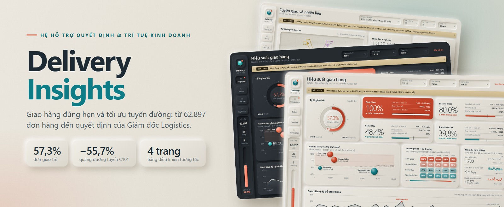

<br>


### Từ 62.897 đơn hàng đến một quyết định của Giám đốc Logistics

**Đơn nào trễ, vì sao, có thể báo trước không, nên hứa lại bao nhiêu ngày và xe nên chạy thế nào?**<br>
Dự án nhóm 7, môn Hệ hỗ trợ quyết định và Trí tuệ kinh doanh.

[**Xem thử bảng điều khiển**](#xem-thử-trong-30-giây) ·
[Kết quả chính](#kết-quả-trong-một-cái-nhìn) ·
[Bảng điều khiển](#bảng-điều-khiển-delivery-insights) ·
[Phương pháp](#phương-pháp) ·
[Cấu trúc](#cấu-trúc-kho-mã) ·
[Đóng góp](CONTRIBUTING.md)

</div>

---

## Bài toán

Một doanh nghiệp bán hàng toàn cầu hứa ngày giao cho khách, nhưng **hơn một nửa số đơn đến trễ hơn lời hứa**. Giám đốc Logistics cần trả lời, bằng dữ liệu chứ không bằng cảm tính:

1. **Điều gì đang xảy ra?** Trễ ở đâu, ở nhóm nào, có đều theo thời gian hay không.
2. **Có báo trước được không?** Một mô hình dự báo đơn trễ đáng tin đến mức nào, và nó bỏ sót bao nhiêu.
3. **Nên làm gì với lời hứa giao hàng?** Hứa lại thêm ngày giảm được bao nhiêu đơn vượt hẹn, và khách phải chờ thêm bao lâu.
4. **Nên chạy xe thế nào?** Một phương án tuyến khả thi cần bao nhiêu xe, quãng đường và nhiên liệu.

Dự án dùng **DataCo Smart Supply Chain** để phân tích giao hàng, và bộ **Solomon VRPTW** (C101, R101, RC101) riêng cho thử nghiệm tuyến. Hai nguồn độc lập nhau và được giữ tách bạch xuyên suốt.

## Kết quả trong một cái nhìn

Để bàn giao phần kể chuyện và nối phát hiện với quyết định logistics, đọc
[flow viết phần VI](deliverables/report/storytelling_handoff.md): dàn ý P0–P5,
bốn hình có nguồn và các lựa chọn để người nhận hoàn thiện ≥2 khuyến nghị.

<table>
<tr>
<td align="center" width="25%"><h2>57,3%</h2>đơn giao trễ<br><sub>36.048 / 62.897 đơn không hủy</sub></td>
<td align="center" width="25%"><h2>100%</h2>First Class trễ<br><sub>cam kết 1 ngày, thực tế luôn 2 ngày</sub></td>
<td align="center" width="25%"><h2>41,6%</h2>đơn trễ đến từ Standard Class<br><sub>dù tỷ lệ trễ của nó chỉ 39,8%</sub></td>
<td align="center" width="25%"><h2>0,746</h2>ROC-AUC mô hình dự báo<br><sub>trên 13.071 đơn kiểm tra</sub></td>
</tr>
<tr>
<td align="center"><h2>57,6% → 26,8%</h2>đơn vượt hẹn<br><sub>khi hứa thêm một ngày</sub></td>
<td align="center"><h2>+0,94 ngày</h2>khách chờ thêm<br><sub>cái giá của phương án trên</sub></td>
<td align="center"><h2>21 → 10 xe</h2>tuyến C101<br><sub>so với phương án điểm gần nhất</sub></td>
<td align="center"><h2>−55,7%</h2>quãng đường<br><sub>1.870,7 → 828,9 đơn vị tọa độ</sub></td>
</tr>
</table>

**Ba điều dữ liệu cho thấy:**

- **Phương thức giao quyết định việc trễ, không phải thị trường hay thời điểm.** Tỷ lệ trễ gần như phẳng giữa 5 thị trường (56,5–57,7%) và 37 tháng (55,0–59,9%), nhưng cách nhau rất xa giữa các phương thức: 100% (First Class), 80% (Second Class), 48% (Same Day), 40% (Standard Class).
- **Tỷ lệ trễ thấp chưa có nghĩa là ít việc phải làm.** Standard Class trễ ít nhất nhưng có khối lượng lớn nhất, nên đóng góp nhiều đơn trễ nhất. Hai hướng cải thiện khác nhau: sửa lời hứa cho nhóm trễ gần hết, và giảm khối lượng trễ cho nhóm lớn.
- **Cảnh báo đáng tin nhưng chưa đủ.** Ở ngưỡng 0,5, mô hình đúng **89,0%** khi báo trễ nhưng mới bắt được **53,9%** đơn trễ thực tế; còn 3.467 đơn trễ chưa được báo.

## Bảng điều khiển Delivery Insights

Bốn trang kể một câu chuyện liền mạch: kết quả, rủi ro, đánh đổi, hành động. Mọi con số được tính lại theo bộ lọc, không có số cố định.

<table>
<tr>
<td width="50%"><a href="docs/assets/dashboard-overview.jpg">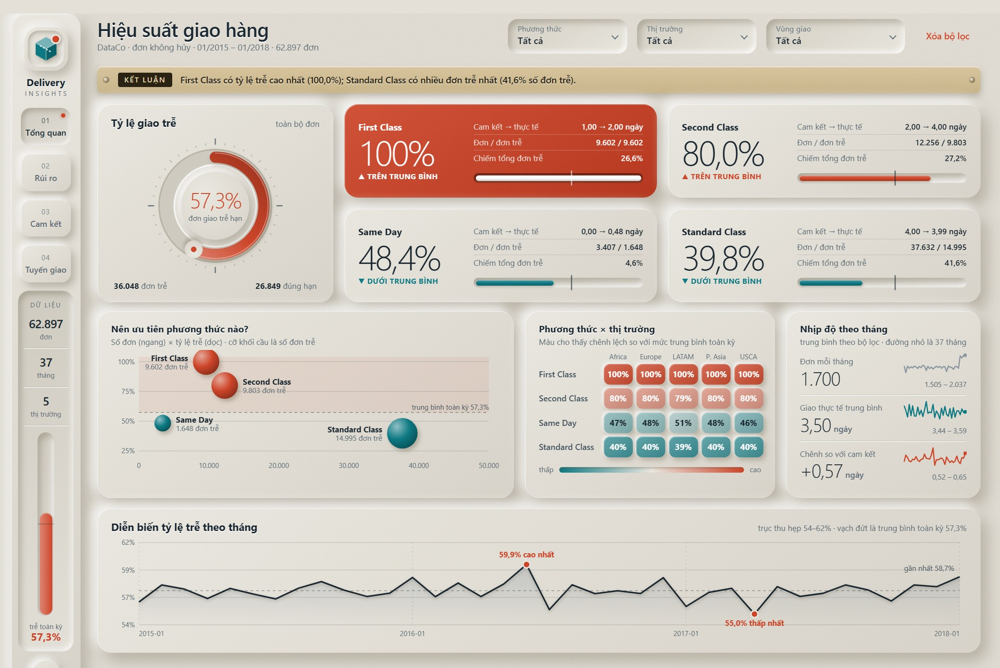</a><br><b>01 · Tổng quan</b><br><sub>Vòng tiến độ tỷ lệ trễ, bốn thẻ phương thức, khối cầu ưu tiên (số đơn × tỷ lệ trễ), phím nhiệt phương thức × thị trường và diễn biến 37 tháng.</sub></td>
<td width="50%"><a href="docs/assets/dashboard-risk.jpg">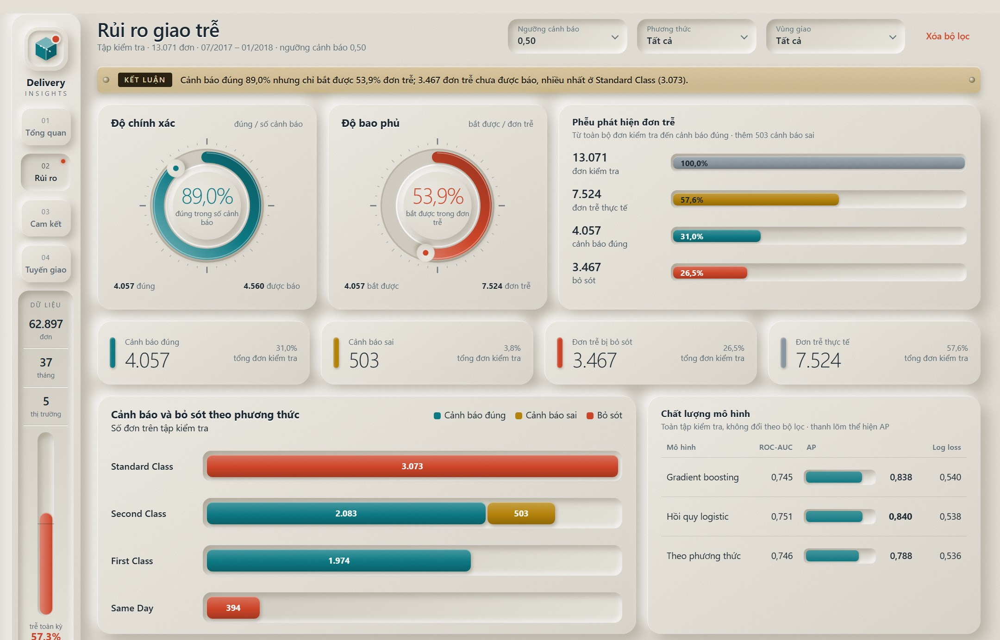</a><br><b>02 · Rủi ro</b><br><sub>Độ chính xác và độ bao phủ của cảnh báo ở ngưỡng tự chọn, phễu phát hiện đơn trễ, đơn bị bỏ sót theo phương thức, chất lượng ba mô hình.</sub></td>
</tr>
<tr>
<td width="50%"><a href="docs/assets/dashboard-promises.jpg">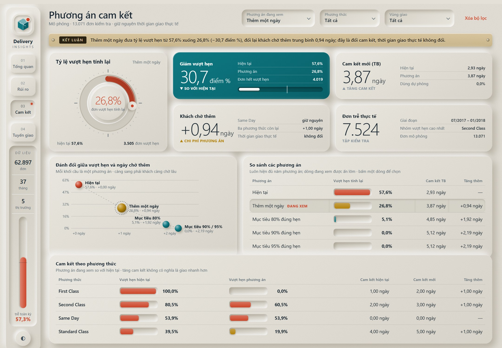</a><br><b>03 · Cam kết</b><br><sub>Năm phương án điều chỉnh lời hứa giao hàng, biểu đồ đánh đổi giữa tỷ lệ vượt hẹn và ngày khách chờ thêm, bảng so sánh theo phương thức.</sub></td>
<td width="50%"><a href="docs/assets/dashboard-routing.jpg">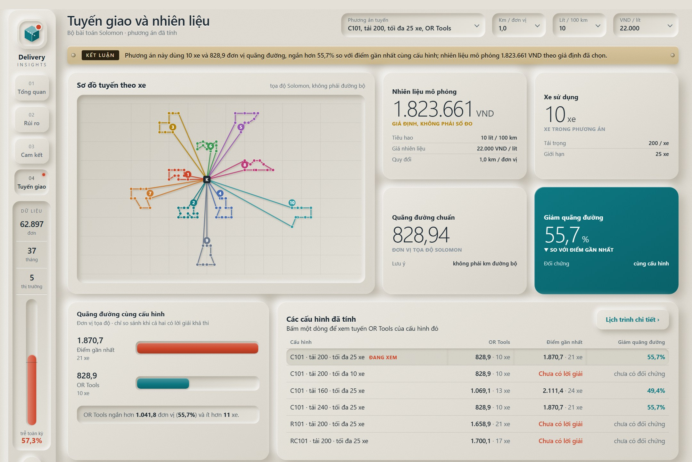</a><br><b>04 · Tuyến giao</b><br><sub>Sơ đồ tuyến theo từng xe, số xe, quãng đường, nhiên liệu mô phỏng theo giả định chỉnh được, so sánh với phương án điểm gần nhất, lịch trình chi tiết.</sub></td>
</tr>
</table>

<details>
<summary><b>Điểm nhấn kỹ thuật và thiết kế</b></summary>

<br>

- **Lọc thật, chéo thật.** Phương thức, thị trường, vùng giao, ngưỡng cảnh báo, phương án cam kết, cấu hình tuyến và giả định nhiên liệu đều chạy trực tiếp trong trình duyệt. Bấm một thẻ, một hàng hay một khối cầu thì mọi biểu đồ khác làm nổi bật phần liên quan.
- **Một file duy nhất.** Khoảng 130 KB, không gọi dịch vụ ngoài, chạy được khi không có mạng. Dữ liệu được tổng hợp thành bốn khối nhỏ (vài trăm dòng mỗi khối) nhúng sẵn trong file.
- **Số liệu kiểm chứng được.** `scripts/check_dashboard_web.py` so các tổng hợp trong trình duyệt với pandas trên CSV gốc qua 17 tổ hợp bộ lọc: **153 phép so sánh, không lệch**.
- **Giao diện bảng điều khiển vật lý.** Khối nổi và ô lõm, vòng tiến độ có núm, khối cầu 3D, dải nhãn kraft chứa kết luận động; hai chế độ sáng và tối; tooltip, chuyển trang và hiệu ứng vào cảnh có thể tắt bằng cài đặt giảm chuyển động của hệ điều hành.
- **Bảng màu có kiểm tra.** Đỏ chu sa (trễ), xanh dầu (đúng hạn), vàng đồng (thận trọng) đã qua kiểm tra phân biệt cho người mù màu; không có thông tin nào chỉ dựa vào màu.
- **Trung thực về giới hạn.** Nhiên liệu được ghi thẳng là giả định, sơ đồ Solomon ghi là tọa độ chứ không phải đường bộ, và đổi lời hứa không bao giờ được mô tả là giao nhanh hơn.

</details>

### Xem thử trong 30 giây

```text
1. Tải hoặc clone kho mã này
2. Mở file  dashboards/web/index.html  bằng Edge, Chrome hoặc Firefox mới
```

Không cần cài Python, Power BI hay dữ liệu. Thêm `#p2`, `#p3`, `#p4` vào đường dẫn để mở thẳng từng trang. Muốn đưa lên mạng, xem [hướng dẫn của bản web](dashboards/web/README.md).

> Nhóm cũng giữ nguồn **Power BI** (`dashboards/powerbi/delivery_dashboard.pbip`) để ai cần làm việc trong Power BI Desktop. Xem [dashboards/README.md](dashboards/README.md).

## Phương pháp

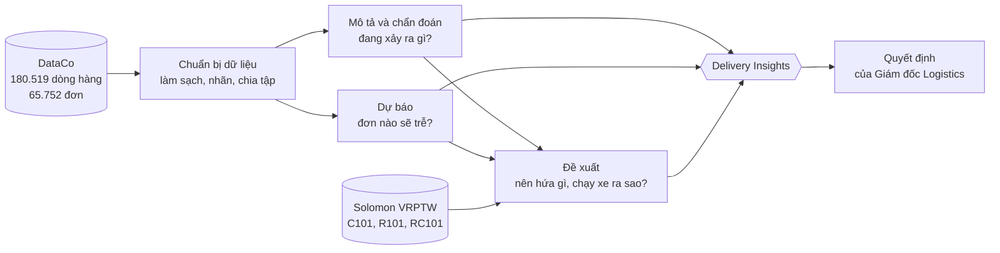

### 1 · Mô tả và chẩn đoán: trễ nằm ở đâu

Trên **62.897 đơn không hủy**, thời gian giao thực tế trung bình là 3,50 ngày so với cam kết 2,94 ngày. Kiểm định chi-bình phương và hệ số Cramér's V xác định yếu tố nào có liên hệ với trễ: phương thức giao là yếu tố nổi bật, còn thị trường và thời điểm gần như không.

<table>
<tr>
<td width="50%">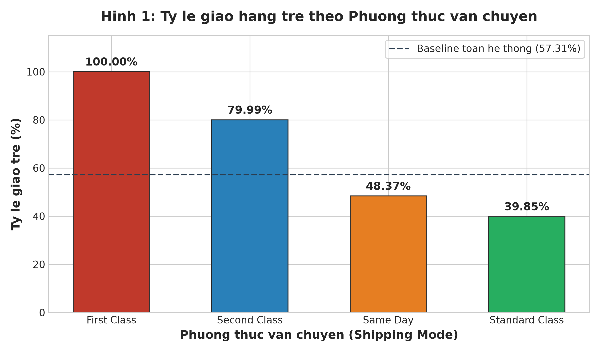</td>
<td width="50%">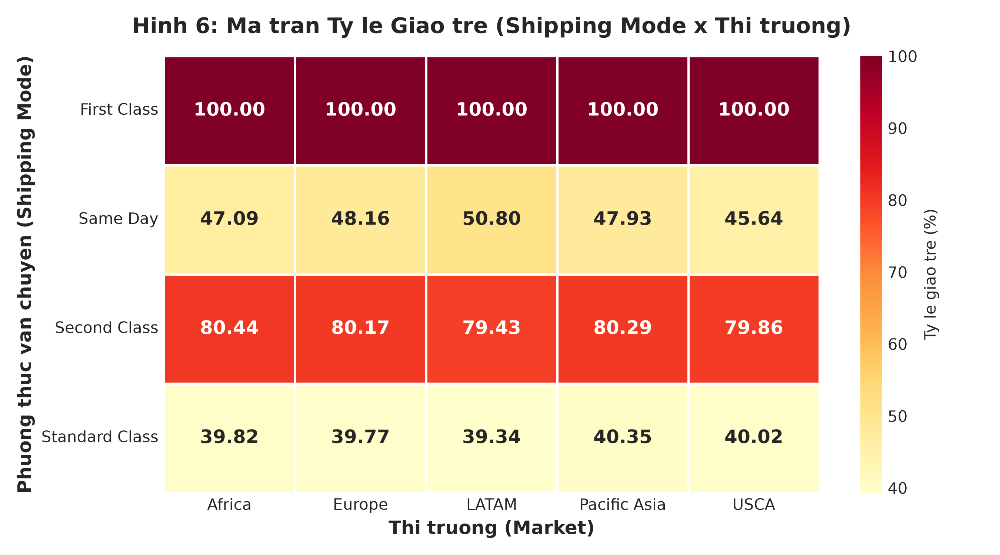</td>
</tr>
<tr>
<td><sub>Tỷ lệ trễ theo bốn phương thức so với mức trung bình.</sub></td>
<td><sub>Mỗi hàng gần như một màu: thị trường không làm đổi kết quả.</sub></td>
</tr>
</table>

Chi tiết: [báo cáo mô tả và chẩn đoán](workstreams/descriptive/README.md) với 12 bảng và 6 biểu đồ.

### 2 · Dự báo: báo trước được đến đâu

Tập dữ liệu chia theo thời gian: train 39.568, validation 9.497, **test 13.071** (07/2017 đến 01/2018) và 761 đơn khoảng đệm. Baseline theo phương thức được chọn bằng log loss trên validation *trước khi* nhìn test; hồi quy logistic và gradient boosting cũng được chạy và so sánh công khai.

| Chỉ số trên tập test | Baseline theo phương thức | Hồi quy logistic | Gradient boosting |
| --- | :---: | :---: | :---: |
| ROC-AUC | 0,746 | 0,751 | 0,745 |
| Average precision | 0,788 | 0,840 | 0,838 |
| Log loss | 0,536 | 0,538 | 0,540 |

Ở ngưỡng 0,5, baseline đạt precision **88,97%**, recall **53,92%**, accuracy 69,63%. Đây là mô hình đơn giản có chủ đích: nó chỉ có bốn mức xác suất (một mức mỗi phương thức), nên **không phân biệt được các đơn trong cùng một phương thức**.

<p align="center">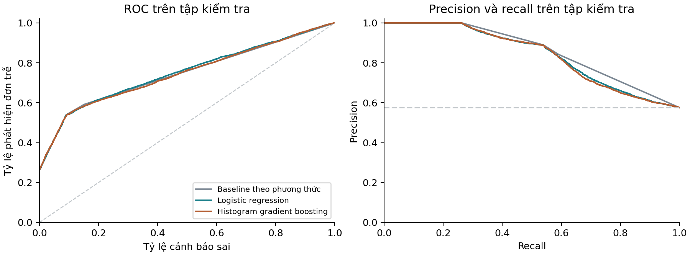</p>

Chi tiết: [bàn giao dự báo](workstreams/forecasting/README.md).

### 3 · Đề xuất: hứa lại thế nào, chạy xe ra sao

**Cam kết.** Năm phương án điều chỉnh lời hứa, mỗi phương án đều đi kèm cái giá khách phải chờ:

| Phương án | Vượt hẹn tính lại | Cam kết trung bình | Khách chờ thêm |
| --- | :---: | :---: | :---: |
| Hiện tại | 57,6% | 2,93 ngày | n/a |
| Thêm một ngày | 26,8% | 3,87 ngày | +0,94 ngày |
| Mục tiêu 80% đúng hẹn | 5,1% | 4,85 ngày | +1,92 ngày |
| Mục tiêu 90% và 95% đúng hẹn | 0,0% | 5,12 ngày | +2,19 ngày |

Phương án "thêm một ngày" nghe hấp dẫn ở mức toàn mẫu, nhưng **Second Class vẫn vượt hẹn 60,5%**, nên không nên áp dụng chung. Đổi lời hứa **không** làm thời gian giao thực tế nhanh hơn, và nhóm không bao giờ trình bày nó như vậy.

**Tuyến.** Giải bài toán định tuyến có khung giờ (VRPTW) trên bộ Solomon và so với phương án lấy điểm gần nhất:

<table>
<tr>
<td width="50%">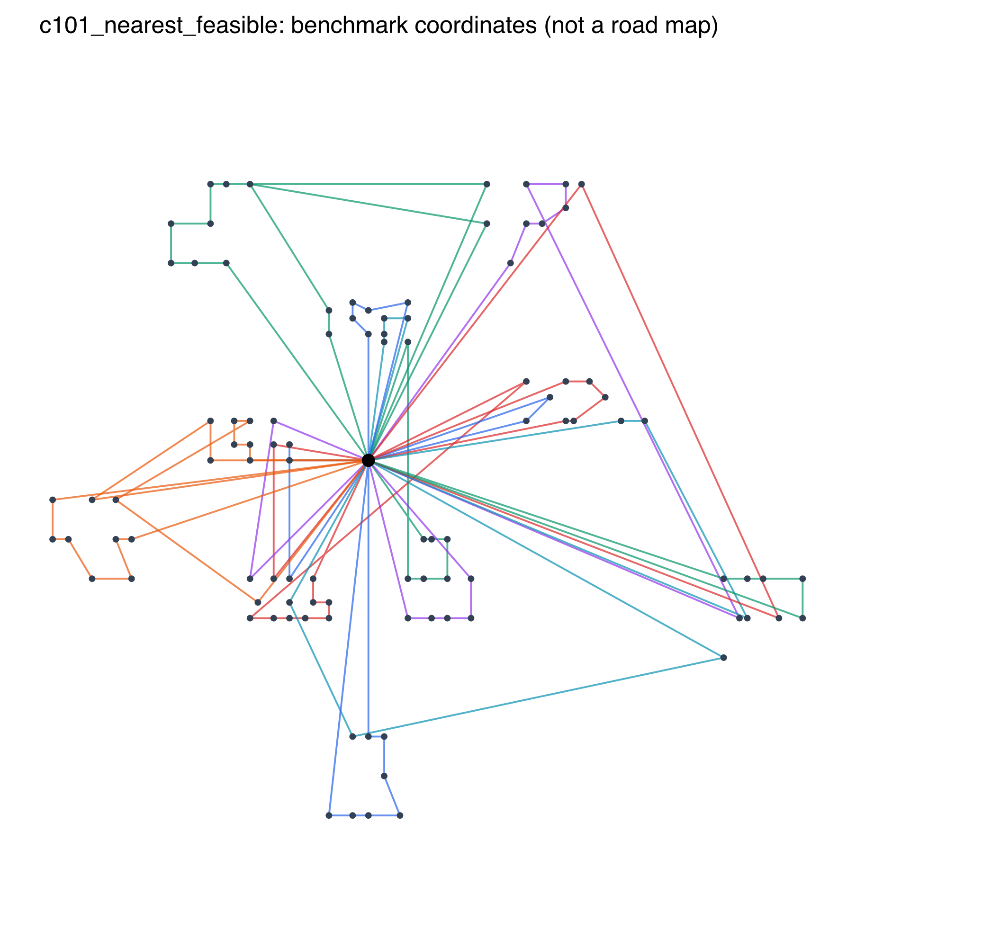</td>
<td width="50%">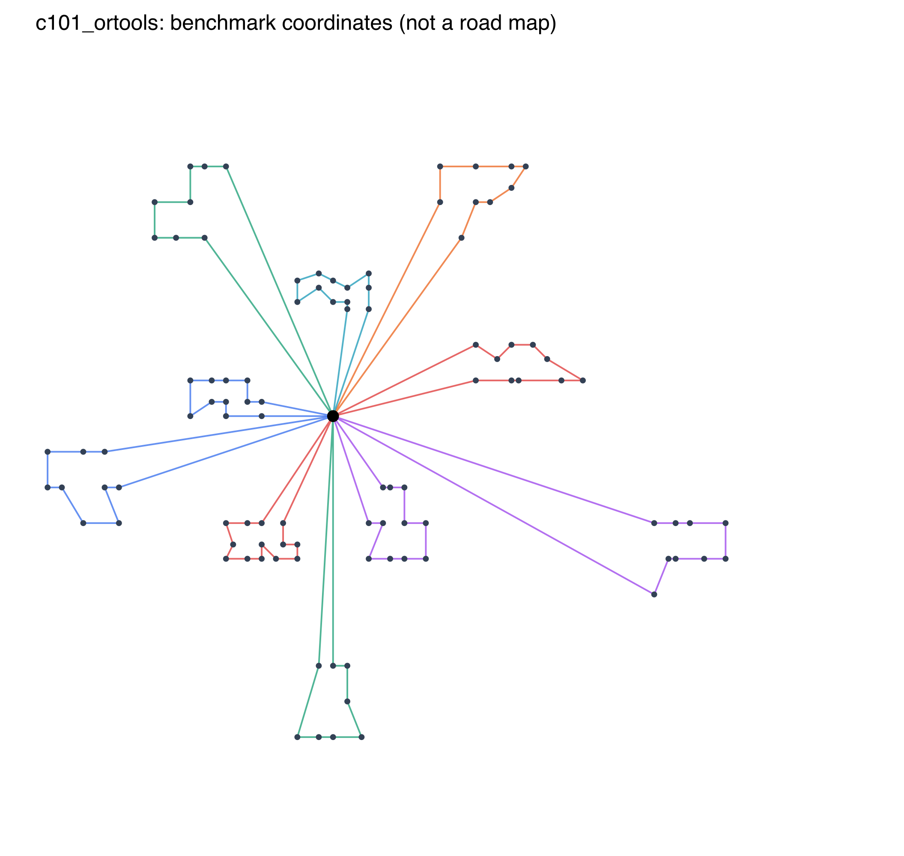</td>
</tr>
<tr>
<td align="center"><b>Điểm gần nhất:</b> 21 xe, 1.870,7 đơn vị</td>
<td align="center"><b>OR-Tools:</b> 10 xe, 828,9 đơn vị</td>
</tr>
</table>

Với C101 (sức chở 200), **10 xe là mức tối thiểu đã được chứng minh** bằng cận dưới sức chở và một tuyến khả thi. Trên R101 và RC101, phương án điểm gần nhất không tìm được lời giải trong khi OR-Tools tìm được (21 và 17 xe): trường hợp này được công khai chứ không bị che đi. Chi tiết: [bàn giao đề xuất](workstreams/prescriptive/README.md).

## Những điều nhóm cố ý nói rõ

Một kết quả đáng tin là kết quả nói rõ nó **không** chứng minh điều gì.

| Điều bạn có thể muốn kết luận | Thực tế dự án cho phép |
| --- | --- |
| "Phương thức X gây ra việc trễ" | Chỉ là **liên hệ** thống kê; không phải quan hệ nhân quả |
| "Mô hình phân biệt từng đơn rủi ro" | Mô hình chỉ có **bốn mức xác suất**, một mức cho mỗi phương thức |
| "Hứa thêm ngày làm giao nhanh hơn" | Chỉ giảm **tỷ lệ vượt hẹn tính lại**; thời gian giao thực tế không đổi |
| "Nhiên liệu tiết kiệm được X đồng" | Nhiên liệu và giá là **giả định mô phỏng**, không phải chi phí thực tế |
| "Quãng đường 828,9 là km" | Là **đơn vị tọa độ Solomon**, chưa phải km đường bộ; chưa chứng minh tối ưu quãng đường |
| "Kết quả áp dụng cho DHL" | DHL chỉ là bối cảnh tham chiếu; dữ liệu là DataCo và Solomon |
| "First Class luôn trễ ngoài đời" | 100% là nhãn trong snapshot nguồn, không phải bảo đảm ngoài thực tế |

## Cấu trúc kho mã

```text
dss-bi-delivery-analytics/
├── dashboards/
│   ├── web/              Bảng điều khiển HTML: index.html dựng sẵn, nguồn template, style, app
│   ├── powerbi/          Nguồn Power BI (PBIP): báo cáo, mô hình, hướng dẫn
│   └── kpi_dictionary.md Định nghĩa chỉ số dùng chung
├── src/dss_bi_delivery/  Chuẩn bị dữ liệu, kiểm chứng, bảng cho dashboard
├── workstreams/
│   ├── descriptive/      Mô tả và chẩn đoán: bảng, biểu đồ, báo cáo
│   ├── forecasting/      Dự báo: kết quả, mô hình, bản chụp mã chuẩn bị
│   └── prescriptive/     Cam kết, tuyến, benchmark Solomon, nhiên liệu
├── docs/                 Bối cảnh, vận hành, thuyết minh dữ liệu, hình cho README
├── deliverables/         Phần viết báo cáo và slide của nhóm
├── reports/              Bằng chứng kiểm tra chất lượng dữ liệu và dashboard
├── scripts/              Kiểm tra tích hợp, dựng và kiểm tra dashboard
├── tests/                Kiểm thử đơn vị
└── references/           Đề bài, manifest nguồn, tài liệu tham chiếu
```

Giải thích từng thư mục và quy tắc lưu trữ: [docs/project/structure.md](docs/project/structure.md).

## Bắt đầu cho người làm việc với mã

```powershell
git clone https://github.com/AIVIETNAM-AIO-LeWann/dss-bi-delivery-analytics.git
cd dss-bi-delivery-analytics
python -m venv .venv
.venv/Scripts/python -m pip install -e .
.venv/Scripts/python -m unittest discover -s tests -v
```

| Việc cần làm | Lệnh | Cần dữ liệu cục bộ |
| --- | --- | :---: |
| Chạy kiểm thử đơn vị | `.venv/Scripts/python -m unittest discover -s tests -v` | Không |
| Kiểm tra checksum tài nguyên và ghép khóa | `.venv/Scripts/python scripts/check_project.py` | Có |
| Dựng lại bảng cho dashboard | `.venv/Scripts/python -m dss_bi_delivery.dashboard_data` | Có |
| Dựng lại bản web | `.venv/Scripts/python scripts/build_dashboard_web.py` | Có |
| Kiểm tra số liệu bản web với pandas | `.venv/Scripts/python scripts/check_dashboard_web.py` | Có |

Dữ liệu thô, bảng sạch và mô hình nhị phân **không nằm trong Git** (dung lượng và giấy phép). Cách khôi phục từ gói gốc nằm ở [hướng dẫn vận hành](docs/project/runbook.md). Các CSV sạch trong thư mục chung được phục hồi từ snapshot bàn giao và có checksum tại `references/restored_data_manifest.json`.

## Nhóm thực hiện

| Phần việc | Thành viên | Điểm vào |
| --- | --- | --- |
| Chuẩn bị dữ liệu | Lê Quang | [Tài liệu](docs/data_preparation/README.md) · `src/dss_bi_delivery/` |
| Mô tả và chẩn đoán | Hoàng Quân | [Bàn giao](workstreams/descriptive/README.md) |
| Dự báo và hạn chế | Ngọc Quang | [Bàn giao](workstreams/forecasting/README.md) |
| Đề xuất và benchmark tuyến | Hoài Phú | [Bàn giao](workstreams/prescriptive/README.md) |
| Dashboard | Anh Quốc | [Bàn giao dashboard](dashboards/README.md) · [bản web](dashboards/web/README.md) |
| Bối cảnh, tổng hợp báo cáo | Phương Quỳnh | `deliverables/report/` |
| Slide | Phương Quỳnh, Anh Quốc | `deliverables/slides/` |

Báo cáo tổng hợp và slide cuối đang được hoàn thiện; xem trạng thái ở [docs/project/context.md](docs/project/context.md).

## Tài liệu

| Tài liệu | Nội dung |
| --- | --- |
| [Bối cảnh và trạng thái](docs/project/context.md) | Phạm vi, luồng dữ liệu, kết quả và giới hạn cần giữ khi trình bày |
| [Bản đồ thư mục](docs/project/structure.md) | Đặt và tìm file ở đâu |
| [Hướng dẫn vận hành](docs/project/runbook.md) | Chạy lại từng phần, khôi phục tài nguyên |
| [Từ điển chỉ số](dashboards/kpi_dictionary.md) | Định nghĩa từng chỉ số của dashboard |
| [Thuyết minh dữ liệu](docs/data_preparation/README.md) | Nguồn, schema, làm sạch, kiểm tra chất lượng |
| [Quy ước cộng tác](CONTRIBUTING.md) | Quy trình làm việc, quy tắc dữ liệu, danh sách kiểm tra trước khi gửi |

## Nguồn dữ liệu và giấy phép

- **DataCo Smart Supply Chain** (Kaggle) cho phân tích giao hàng; **Solomon VRPTW** (C101, R101, RC101) cho thử nghiệm tuyến.
- Chín tệp nguồn được kiểm tra SHA-256; tra tên cũ và tên mới tại `references/resource_manifest.json`. Slug Kaggle trong đề bài và trong manifest khác nhau và chưa được chứng minh trùng byte.
- Tài liệu và dữ liệu bên thứ ba giữ giấy phép riêng của chúng. Kho mã này chưa cấp một giấy phép chung cho các tài nguyên đó.
- Quy tắc trong prompt của đề bài là nội dung tham khảo, không phải lệnh tự động cho công cụ.

<div align="center">

<sub>Dự án nhóm 7 · Hệ hỗ trợ quyết định và Trí tuệ kinh doanh · HK261</sub>

</div>
