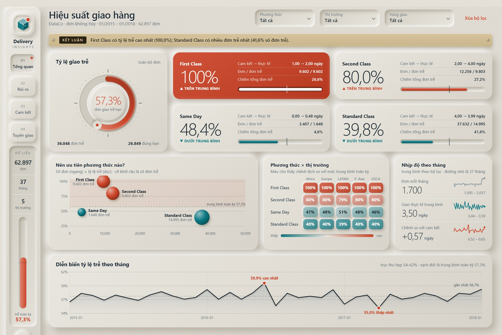
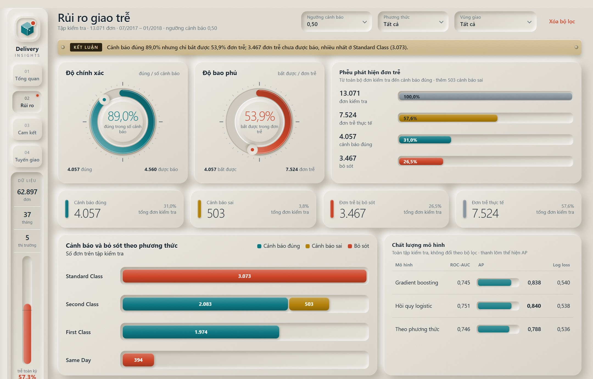
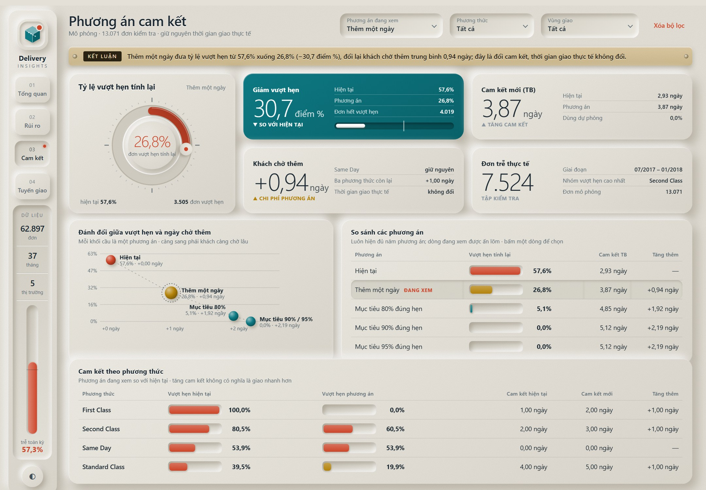
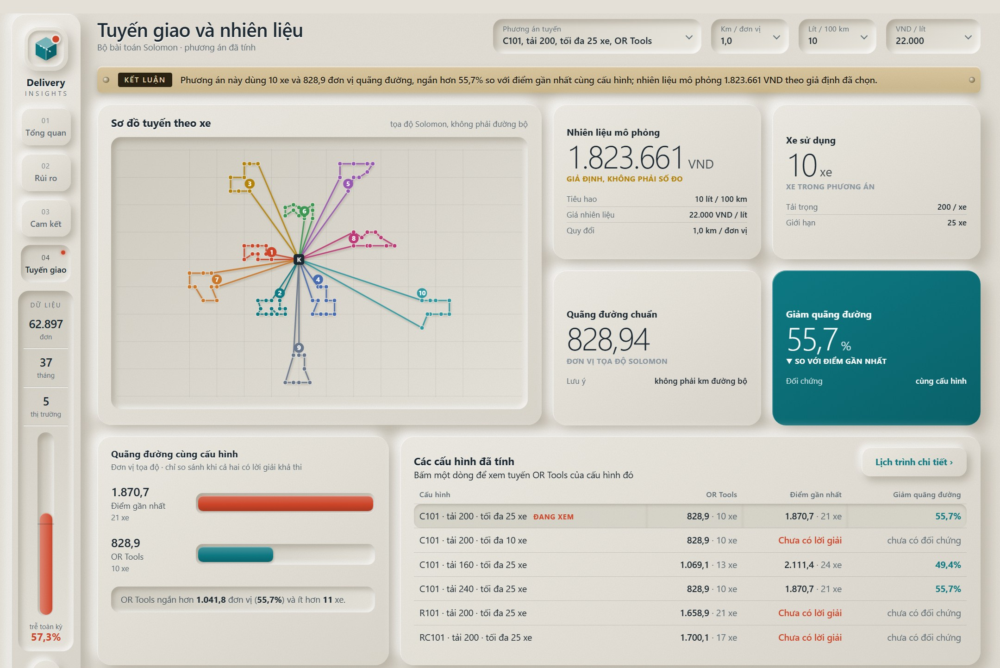
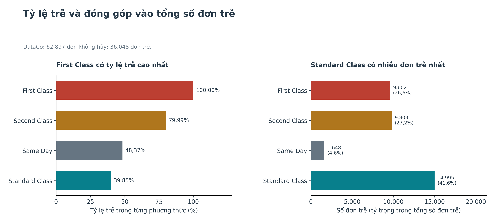
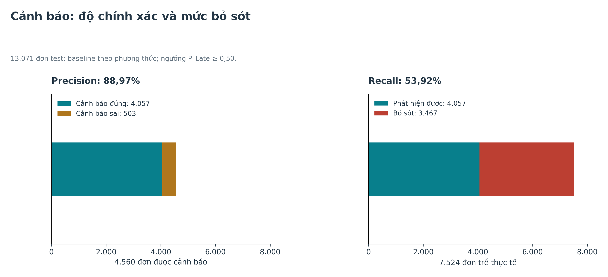
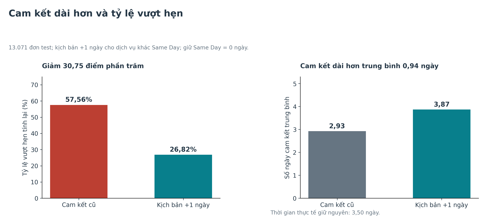
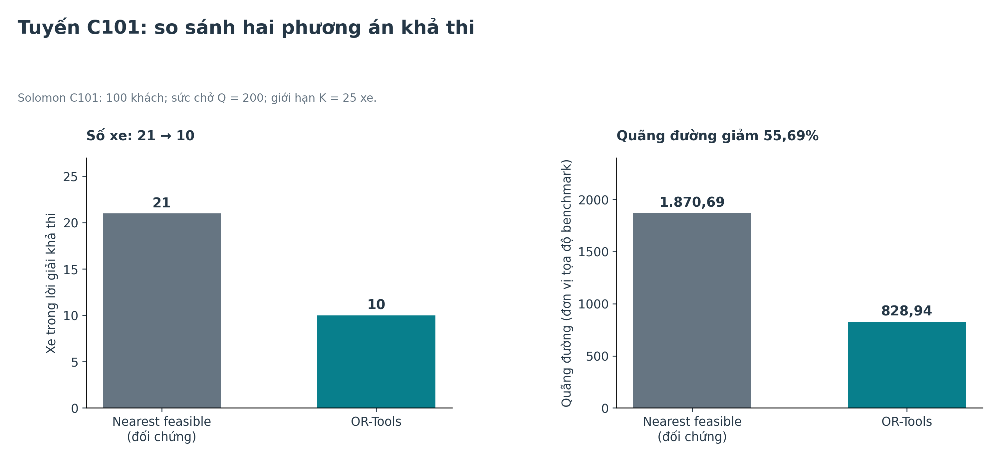
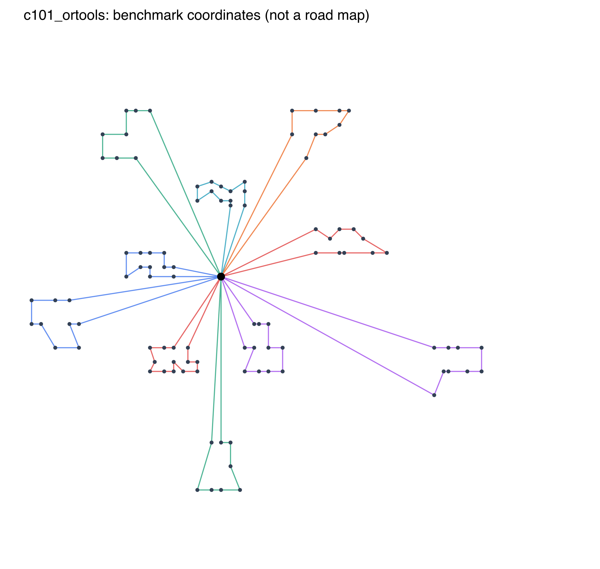

# Phần VI – R: Kết quả, Kể chuyện Dữ liệu, Thông điệp Chính và Khuyến nghị

**Chủ đề 18:** Giao hàng đúng hẹn và tối ưu tuyến đường (*Delivery Performance & Route Optimization*)  
**Người nhận quyết định:** Giám đốc Logistics  
**Hoàn thiện thông điệp & khuyến nghị (19/11/2026):** Hoàng Quân (TV3) — kế thừa tích hợp Dashboard của Anh Quốc (TV6, [`section_vi_dashboard.md`](section_vi_dashboard.md)) và bàn giao kể chuyện dữ liệu của Lê Quang (TV2, [`storytelling_handoff.md`](storytelling_handoff.md)) trên dữ liệu nguồn TV2–TV5.

> **Lưu ý phạm vi và ngữ cảnh trình bày:**
> 1. Cụm *"quyết định HR"* xuất hiện trong mẫu bảng phân công chung là phần còn sót từ đề nhân sự cũ; với Chủ đề 18, đối tượng ra quyết định là **Giám đốc Logistics**, xoay quanh cam kết giao hàng, sử dụng cảnh báo rủi ro và kiểm chứng phương án tuyến.
> 2. **DHL** chỉ là bối cảnh tham chiếu nghiệp vụ; dữ liệu **DataCo Smart Supply Chain** và benchmark **Solomon VRPTW** là hai nguồn độc lập nhau và không được gọi là dữ liệu vận hành thực tế của DHL.
> 3. Phạm vi phân tích không bao gồm lựa chọn nhà vận chuyển hoặc định giá phí giao hàng.

---

## 6.1. Kết quả tích hợp và Hệ thống Dashboard Delivery Insights

Bảng điều khiển **Delivery Insights** đã tích hợp đồng bộ dữ liệu sạch, phân tích mô tả/chẩn đoán, xác suất dự báo rủi ro và các phương án chính sách/tuyến thành một hệ thống theo dõi thống nhất gồm **hai phiên bản cùng nội dung** (cả hai đều tính lại toàn bộ chỉ số theo bộ lọc hiện hành, không gán số cố định):

1. **Bản Power BI native (`dashboards/powerbi/`):** gồm 4 trang phân tích chính (`Tổng quan`, `Rủi ro`, `Cam kết`, `Tuyến giao`) và 1 trang chi tiết `Lịch trình tuyến` có sơ đồ nối tuyến theo từng xe qua image visual native. Bộ lọc `shipping_mode`, `market`, `order_region` đồng bộ giữa các trang DataCo; trang Tuyến tách độc lập với DataCo và giữ bộ chọn tham số nhiên liệu sang trang Lịch trình.
2. **Bản Web HTML tự chạy (`dashboards/web/index.html`):** mở trực tiếp trên trình duyệt, tính lại các tổng hợp khớp với định nghĩa Power BI trong [`dashboards/kpi_dictionary.md`](../../dashboards/kpi_dictionary.md).

**Trạng thái kiểm chứng kỹ thuật tại thời điểm bàn giao:** theo [`reports/dashboard/`](../../reports/dashboard/README.md), bộ đầu vào đạt **84/84** kiểm tra trong `input_validation.json`; cấu trúc Power BI qua kiểm tra **534** tệp lược đồ và **521** tham chiếu/bố cục visual (`12` bảng, `145` measures trong `powerbi_validation.json`); khi mở và làm mới trực tiếp trên Power BI Desktop, **26/26** kiểm tra DAX native đạt (`native_dax_validation.json`), 5 trang đều không phát hiện lỗi chữ hay chồng lấn hình học ở hai kích thước `2400 × 1580` và `1366 × 900` (`native_render_validation.json`).

### Bảng 6.1: Tổng hợp 4 trang chính của Dashboard Delivery Insights

| Trang Dashboard | Điểm neo | Câu hỏi hỗ trợ quyết định | Phạm vi & Mẫu số chuẩn | Hình minh họa |
| :--- | :---: | :--- | :--- | :---: |
| **01 · Tổng quan** | `#p1` | Hiện trạng trễ ra sao và phương thức nào cần ưu tiên rà soát? | `62.897` đơn không hủy (`36.048` đơn trễ = `57,31%`) | Hình 1 |
| **02 · Rủi ro** | `#p2` | Ở ngưỡng cảnh báo chọn trước, hệ thống tạo bao nhiêu cảnh báo đúng/sai và bỏ sót bao nhiêu đơn? | `13.071` đơn tập test (`7.524` đơn trễ thực tế = `57,56%`), ngưỡng mặc định `0,50` | Hình 2 |
| **03 · Cam kết** | `#p3` | Khi điều chỉnh ngày cam kết, tỷ lệ vượt hẹn tính lại giảm bao nhiêu và khách phải chờ thêm bao nhiêu ngày? | `13.071` đơn tập test; giữ `shipping_days_actual` không đổi; so sánh đủ 5 phương án | Hình 3 |
| **04 · Tuyến giao** | `#p4` | Trên cấu hình benchmark Solomon, lời giải OR-Tools cần bao nhiêu xe, quãng đường và chi phí nhiên liệu mô phỏng? | Benchmark Solomon VRPTW (`100` khách/instance), **độc lập hoàn toàn** với DataCo | Hình 4 |

---

## 6.2. Kể chuyện dữ liệu theo mạch lập luận P0–P5

Toàn bộ kết quả phân tích từ TV2–TV5 được tổ chức thành một mạch lập luận nhất quán để phục vụ quyết định của Giám đốc Logistics:

> **Mạch lập luận cốt lõi:** Quy mô vượt hẹn lớn → hai cách xác định nhóm ưu tiên (theo tỷ lệ trễ và theo khối lượng trễ) → cảnh báo theo nhóm đạt độ chính xác cao nhưng bỏ sót gần một nửa đơn trễ → điều chỉnh cam kết giảm vượt hẹn tính lại kèm đánh đổi chờ đợi và chưa xử lý hết Second Class → tối ưu tuyến có bằng chứng benchmark Solomon độc lập cần kiểm chứng trên dữ liệu vận hành thực tế.

---

### P0 — Mở bối cảnh: Quy mô vấn đề vượt cam kết lớn đến đâu?

Trong mẫu phân tích chuẩn hóa gồm **`62.897` đơn hàng không hủy**, có **`36.048` đơn** mang nhãn giao trễ, tương ứng **`57,31%`**. Thời gian cam kết trung bình là **`2,94` ngày** trong khi thời gian giao thực tế ghi nhận trung bình **`3,50` ngày** (độ lệch chuẩn **`1,62` ngày**).

- **Phân biệt mẫu số nguồn:** Trên toàn bộ nguồn gốc gồm cả `2.855` đơn hủy (`65.752` đơn), tỷ lệ trễ là **`54,82%`** do đơn hủy mang nhãn trễ bằng `0` (`reports/data_quality/baseline_kpis.csv`). Báo cáo giữ `62.897` đơn không hủy làm mẫu số phân tích mô tả/chẩn đoán chính và không thay thế hai mẫu số này cho nhau.
- **Giới hạn mở bối cảnh:** Các trạng thái không hủy trong DataCo chưa có xác nhận độc lập thời điểm khách thực nhận ngoài bản dữ liệu lịch sử; con số `57,31%` mới phản ánh quy mô vượt hẹn tổng thể, chưa chỉ ra nên ưu tiên can thiệp vào nhóm dịch vụ nào.

---

### P1 / F1 — Nhóm ưu tiên theo tỷ lệ trễ khác nhóm ưu tiên theo khối lượng trễ

Ưu tiên theo **tỷ lệ trễ** và ưu tiên theo **số đơn bị ảnh hưởng** dẫn đến hai nhóm dịch vụ khác nhau hoàn toàn trong mẫu **`62.897` đơn không hủy**:

#### Bảng 6.2: Hiệu suất giao hàng theo Phương thức vận chuyển (`n = 62.897` đơn không hủy)

| Phương thức vận chuyển | Tổng số đơn | Số đơn trễ | Tỷ lệ trễ (%) | Tỷ trọng trong `36.048` đơn trễ (%) | Cam kết TB (ngày) | Thực tế TB (ngày) |
| :--- | :---: | :---: | :---: | :---: | :---: | :---: |
| **First Class** | `9.602` | `9.602` | **100,00%** | `26,64%` | `1,00` | `2,00` |
| **Second Class** | `12.256` | `9.803` | **79,99%** | `27,19%` | `2,00` | `4,00` |
| **Same Day** | `3.407` | `1.648` | **48,37%** | `4,57%` | `0,00` | `0,48` |
| **Standard Class** | `37.632` | `14.995` | **39,85%** | **41,60%** | `4,00` | `3,99` |
| **Toàn mẫu phân tích** | **`62.897`** | **`36.048`** | **`57,31%`** | **`100,00%`** | **`2,94`** | **`3,50`** |

*(Nguồn: [`01_shipping_mode_detailed.csv`](../../workstreams/descriptive/tables/01_shipping_mode_detailed.csv) và [`evidence.json`](../../reports/storytelling/evidence.json)).*

- **Hai hướng ưu tiên rõ rệt:**
  - Nếu ưu tiên kiểm tra **mức độ giữ lời hứa dịch vụ**, trọng tâm là **First Class** (`9.602 / 9.602` đơn trễ = `100,00%`, cam kết `1,00` ngày nhưng thực tế luôn `2,00` ngày) và **Second Class** (`9.803 / 12.256` đơn trễ = `79,99%`, cam kết `2,00` ngày nhưng thực tế TB `4,00` ngày).
  - Nếu ưu tiên **quy mô số đơn chịu ảnh hưởng**, **Standard Class** có tỷ lệ trễ thấp nhất (`39,85%`) nhưng lại đóng góp **`14.995` đơn trễ**, chiếm **`41,60%`** tổng số đơn trễ toàn hệ thống.
- **Kết quả kiểm định liên hệ trong mẫu:** Theo [`11_chi2_independence_tests.csv`](../../workstreams/descriptive/tables/11_chi2_independence_tests.csv), biến `shipping_mode` có liên hệ rất mạnh với nhãn trễ ($\chi^2 = 14.530,75$; $p < 0,0001$; Cramér's $V = 0,4807$). Ngược lại, theo thị trường (`market`: tỷ lệ trễ dao động hẹp `56,55%–57,68%`; $\chi^2 = 3,18$; $p = 0,5289$; $V = 0,0071$) và theo 23 vùng (`order_region`: $\chi^2 = 30,67$; $p = 0,1031$; $V = 0,0221$) **chưa tìm thấy bằng chứng về liên hệ với rủi ro trễ trong phép kiểm định này**.
- **Giới hạn diễn giải:** Liên hệ thống kê trong mẫu lịch sử không chứng minh quan hệ nhân quả hay bảo đảm địa lý không quan trọng trong tương lai; mẫu hình `100%` trễ của First Class là đặc tính của snapshot hiện có, chưa bảo đảm bất biến ngoài mẫu; và khối lượng đơn trễ lớn ở Standard Class không đồng nghĩa có thể giảm ngay toàn bộ số đơn đó khi chưa có bằng chứng tác động của giải pháp.

---

### P2 / F2 — Cảnh báo rủi ro đạt precision cao ở nhóm nhưng bỏ sót gần một nửa đơn trễ

Trên **`13.071` đơn tập test theo thời gian** (trong đó có **`7.524` đơn trễ thực tế**, tương ứng `57,56%`), TV4 lựa chọn mô hình **`mode_baseline`** theo tiêu chí **log loss validation thấp nhất** (`0,5418`, thấp hơn `logistic_regression` `0,5452` và `hist_gradient_boosting` `0,5456`). Mô hình đạt **ROC-AUC = `0,746`** trên tập test với đúng **4 mức xác suất dự báo (`P_Late`) theo phương thức** (ước lượng trên `39.568` đơn train: First Class `100,00%`, Second Class `80,09%`, Same Day `46,03%`, Standard Class `40,05%`).

- **Hiệu quả tại ngưỡng `0,50`:** Mô hình phát ra **`4.560` cảnh báo** (chiếm **`34,89%`** tập test, gồm toàn bộ các đơn `First Class` và `Second Class` trong tập test), trong đó **`4.057` cảnh báo đúng** và **`503` cảnh báo sai**, đạt **Precision = `88,97%`**. Tuy nhiên, đối chiếu trên **`7.524` đơn trễ thực tế**, hệ thống mới bắt được `4.057` đơn (**Recall = `53,92%`**) và **bỏ sót `3.467` đơn trễ** (chủ yếu thuộc `Standard Class` và `Same Day` do `P_Late < 0,50`).
- **Giới hạn phải đi cùng:**
  1. `P_Late` được ước lượng theo **cam kết cũ** và **có điều kiện không hủy**; mô hình chưa phân biệt được rủi ro riêng giữa các đơn trong cùng một phương thức.
  2. Tỷ lệ `34,89%` là tỷ trọng cảnh báo trên tập test lịch sử, không phải số lượng cảnh báo/ngày thực tế của doanh nghiệp; đồng thời chưa chứng minh được việc giảm trễ khi can thiệp chỉ dựa trên cảnh báo nếu chưa có thử nghiệm đối chứng.

---

### P3 / F3 — Điều chỉnh cam kết giảm mạnh vượt hẹn tính lại nhưng đánh đổi thời gian chờ và chưa xử lý hết Second Class

Trên cùng **`13.071` đơn tập test** của P2, phương án mô phỏng hồi cứu giới hạn cộng tối đa `+1` ngày và giữ nguyên `Same Day = 0` (**`bounded_plus1_keep_same_day`** trong [`promise_summary.csv`](../../workstreams/prescriptive/results/promise_summary.csv) và [`pilot_by_mode_test.csv`](../../workstreams/prescriptive/results/pilot_by_mode_test.csv)) cho thấy đồng thời lợi ích và đánh đổi:

#### Bảng 6.3: Đối chiếu hiệu quả mô phỏng hồi cứu theo từng phương thức trên tập test (`n = 13.071` đơn)

| Phương thức vận chuyển | Số đơn test | Cam kết cũ → mới (ngày) | Vượt hẹn cũ (số đơn / %) | Vượt hẹn tính lại sau `+1` ngày (số đơn / %) | Mức thay đổi (điểm %) |
| :--- | :---: | :---: | :---: | :---: | :---: |
| **First Class** | `1.974` | `1 → 2` | `1.974` (`100,00%`) | `0` (**`0,00%`**) | `-100,00` |
| **Second Class** | `2.586` | `2 → 3` | `2.083` (`80,55%`) | `1.565` (**`60,52%`**) | `-20,03` |
| **Standard Class** | `7.780` | `4 → 5` | `3.073` (`39,50%`) | `1.546` (**`19,87%`**) | `-19,63` |
| **Same Day** *(giữ nguyên)* | `731` | `0 → 0` | `394` (`53,90%`) | `394` (`53,90%`) | `0,00` |
| **Toàn tập test** | **`13.071`** | **`2,93 → 3,87`** | **`7.524` (`57,56%`)** | **`3.505` (`26,82%`)** | **`-30,75`** |

*(Nguồn: [`pilot_by_mode_test.csv`](../../workstreams/prescriptive/results/pilot_by_mode_test.csv) và [`promise_summary.csv`](../../workstreams/prescriptive/results/promise_summary.csv); `changed_orders = 12.340` đơn không thuộc Same Day).*

- **Lợi ích và cái giá đi kèm:** Tỷ lệ vượt hẹn tính lại toàn tập test giảm từ **`57,56%`** xuống **`26,82%`** (giảm **`30,75` điểm phần trăm**), đổi lại **số ngày cam kết trung bình tăng thêm `+0,94` ngày** (từ `2,93` lên `3,87` ngày), trong khi **thời gian giao hàng thực tế trung bình giữ nguyên ở mức `3,50` ngày** (`3,4968`).
- **Điểm nghẽn cần tách riêng ở Second Class:** Dù áp dụng `+1` ngày (`2 → 3` ngày), **Second Class vẫn còn `60,52%` đơn vượt hẹn** (`1.565 / 2.586` đơn). Do đó, mức giảm toàn mẫu `30,75` điểm phần trăm không đủ làm căn cứ áp dụng đồng loạt cho mọi phương thức mà phải xem xét riêng từng gói dịch vụ.
- **Giới hạn phải đi cùng:** Đây là **mô phỏng hồi cứu giữ `shipping_days_actual` cố định**; kết quả **không** chứng minh giao hàng nhanh hơn, không chứng minh hài lòng khách hàng tăng lên hay phát sinh ROI tài chính thực, và `P_Late` tính trên cam kết cũ không còn là xác suất vượt hẹn dưới mức cam kết mới.

---

### P4 / F4 — Tối ưu tuyến đường có bằng chứng benchmark độc lập trên Solomon C101

Vì tập DataCo không có tọa độ điểm dừng giao hàng thực tế, tải trọng đội xe hay khung giờ phục vụ từng điểm, bài toán xếp tuyến giao hàng nội thành (VRPTW) được kiểm chứng **tách biệt hoàn toàn** trên bộ chuẩn **Solomon VRPTW** (`100` khách hàng chuẩn/instance).

#### Bảng 6.4: Tổng hợp kết quả benchmark Solomon VRPTW giữa hai phương pháp (`routing_summary.csv` & `fleet_sizing_bounds.csv`)

| Instance / Kịch bản | Ràng buộc (`Q`, `K`) | Cận dưới tải xe | Đối chứng `nearest_feasible` (Xe / Quãng đường) | Bộ giải `OR-Tools` (Xe / Quãng đường) | Nhận xét đối chiếu |
| :--- | :---: | :---: | :---: | :---: | :--- |
| **`c101 / base`** | `Q=200, K=25` | **`10` xe** | `21` xe / `1.870,69` đv tọa độ | **`10` xe / `828,94` đv tọa độ** | Cả hai khả thi; **đạt cận dưới tải `10` xe**; quãng đường thấp hơn **`55,69%`** so với đối chứng |
| `c101 / fleet10` | `Q=200, K=10` | `10` xe | *Chưa có lời giải* | `10` xe / `828,94` đv tọa độ | Đối chứng không giải được dưới trần 10 xe |
| `c101 / capacity160` | `Q=160, K=25` | `12` xe | `24` xe / `2.111,42` đv tọa độ | `13` xe / `1.069,11` đv tọa độ | Quãng đường giảm từ `2.111,42` xuống `1.069,11` |
| `c101 / capacity240` | `Q=240, K=25` | `8` xe | `21` xe / `1.870,69` đv tọa độ | `10` xe / `828,94` đv tọa độ | Giới hạn khung giờ chi phối cận trên đội xe |
| `r101 / base` | `Q=200, K=25` | `8` xe | *Chưa có lời giải* | `21` xe / `1.658,86` đv tọa độ | Không có đối chứng khả thi nên không tính % giảm |
| `rc101 / base` | `Q=200, K=25` | `9` xe | *Chưa có lời giải* | `17` xe / `1.700,09` đv tọa độ | Không có đối chứng khả thi nên không tính % giảm |

*(Nguồn: [`routing_summary.csv`](../../workstreams/prescriptive/results/routing_summary.csv) và [`fleet_sizing_bounds.csv`](../../workstreams/prescriptive/results/fleet_sizing_bounds.csv); tổng nhu cầu C101 là `1.810`, nên cận dưới tải $\lceil 1.810 / 200 \rceil = 10$ xe).*

- **Bằng chứng và giới hạn nghiêm ngặt:**
  - Trên cấu hình **`C101 / base`**, OR-Tools đạt lời giải khả thi đúng bằng cận dưới đội xe (`10` xe) và tổng quãng đường **`828,94` đơn vị tọa độ Solomon**, thấp hơn **`55,69%`** so với đối chứng `nearest_feasible` (`21` xe, `1.870,69` đơn vị tọa độ).
  - **Không được hiểu nhầm:** Quãng đường là **đơn vị tọa độ Euclid Solomon, không phải km đường bộ**; công cụ **chưa chứng minh tối ưu toán học toàn cục** cho quãng đường (nhiều kịch bản chạy theo giới hạn thời gian); các trường hợp đối chứng `nearest_feasible` không tìm được lời giải thì **để trống, tuyệt đối không quy về `0`** và không tính % tiết kiệm; không cộng gộp kết quả tuyến Solomon với phần trăm vượt hẹn DataCo thành lợi ích tài chính của một doanh nghiệp đơn lẻ, và các chi phí nhiên liệu trên Dashboard là giá trị mô phỏng theo giả định.

---

### P5 — Thông điệp chính dành cho Giám đốc Logistics

1. **Vấn đề giao trễ tập trung ở chính sách cam kết theo phương thức vận chuyển (`V = 0,4807` trên `62.897` đơn), chưa tìm thấy bằng chứng về liên hệ theo thị trường hay thứ đặt hàng trong phép kiểm định này;** trong đó `First Class` (`100%` trễ) dẫn đầu về tỷ lệ vi phạm cam kết còn `Standard Class` (`41,60%` tổng đơn trễ) dẫn đầu về quy mô đơn bị ảnh hưởng.
2. **Mô hình dự báo hiện tại hỗ trợ tốt việc khoanh vùng nhóm rủi ro (`Precision = 88,97%` tại ngưỡng `0,50` trên `13.071` đơn test) nhưng mới bao phủ `53,92%` đơn trễ,** còn mô phỏng nới cam kết `+1` ngày có thể hạ tỷ lệ vượt hẹn tính lại từ `57,56%` xuống `26,82%` với đánh đổi `+0,94` ngày cam kết nhưng vẫn để lại `60,52%` đơn `Second Class` vượt hẹn.
3. **Ở mảng điều độ tuyến nội thành, bộ giải OR-Tools chứng minh khả năng lập tuyến khả thi ở cận dưới đội xe (`10` xe, `828,94` đơn vị tọa độ trên benchmark Solomon `C101`),** tạo căn cứ kỹ thuật để chuyển sang kiểm chứng nghiệp vụ bằng dữ liệu đội xe và điểm giao thực tế trước khi đánh giá hiệu quả vận hành.

---

## 6.3. Ba Khuyến nghị Hoàn thiện Có Trực quan hóa Hỗ trợ

Các khuyến nghị dưới đây chuyển trực tiếp bốn phát hiện `F1–F4` thành phương án hành động có điều kiện cho **Giám đốc Logistics**, tuân thủ ranh giới phạm vi đề tài (không chọn nhà vận chuyển, không định giá cước) và chỉ giữ các con số có kiểm chứng.

### Khuyến nghị 1 (Từ F1 & F3): Thí điểm điều chỉnh cam kết thời gian giao theo từng phương thức vận chuyển, tách riêng bài toán Second Class

- **Hành động & Phạm vi:** Không điều chỉnh cam kết đồng loạt toàn hệ thống mà triển khai **thí điểm có kiểm soát (pilot theo gói dịch vụ)** dựa trên phương án giới hạn `+1` ngày và giữ `Same Day = 0` trên dữ liệu không hủy: ưu tiên rà soát trước **First Class** (mẫu phân tích `62.897` đơn không hủy có `9.602 / 9.602` đơn trễ với cam kết `1` ngày vs thực tế luôn `2` ngày; trên tập test `1.974` đơn, mức `+1` ngày đưa vượt hẹn tính lại từ `100,00%` về `0,00%`) và cân nhắc thí điểm ở **Standard Class** (đóng góp `41,60%` tổng đơn trễ toàn mẫu phân tích; trên `7.780` đơn test, vượt hẹn tính lại giảm từ `39,50%` xuống `19,87%`). Riêng **Second Class** (`60,52%` đơn test vẫn vượt hẹn ở mức `+1` ngày tức `3` ngày cam kết so với thực tế bình quân `4,00` ngày) phải được tách ra đánh giá mức cam kết/quy trình xử lý riêng chứ không áp chung quy tắc `+1` ngày. Phạm vi giữ nguyên, không bàn về đổi giá cước hay thay đổi hãng vận chuyển.
- **Bằng chứng & Trực quan hóa hỗ trợ:**
  - **Hình 5** ([`story_01_priority.png`](figures/story_01_priority.png)) & Dashboard trang **Tổng quan (`#p1`, Hình 1)**: phân biệt rõ hai cực ưu tiên `First Class` (`100,00%` trễ) và `Standard Class` (`41,60%` tổng đơn trễ).
  - **Hình 7** ([`story_03_promise_tradeoff.png`](figures/story_03_promise_tradeoff.png)) & Dashboard trang **Cam kết (`#p3`, Hình 3)**: cho thấy trên `13.071` đơn test, vượt hẹn tính lại giảm `30,75` điểm phần trăm (`57,56% → 26,82%`) đi cùng đánh đổi `+0,94` ngày cam kết (`2,93 → 3,87`), thời gian thực tế giữ nguyên `3,50` ngày, và `Second Class` còn `60,52%` vượt hẹn.
- **Chức danh nghiệp vụ thực hiện:**
  - *Phê duyệt:* **Giám đốc Logistics**.
  - *Chủ trì:* **Quản lý Dịch vụ Vận chuyển & Vận hành Giao nhận**.
  - *Phối hợp:* **Bộ phận Thương mại / Chăm sóc Khách hàng** (đánh giá mức chấp nhận chờ của khách) và **Đội Dữ liệu / BI** (theo dõi đối chứng trên Dashboard `#p3`).
- **Điều kiện áp dụng & Dữ liệu cần thu thập thêm:**
  - Mục tiêu tỷ lệ đúng hẹn được ban lãnh đạo phê duyệt cho từng dịch vụ và ngưỡng tăng ngày cam kết tối đa mà thương mại chấp nhận.
  - Dữ liệu phản hồi của khách hàng, tỷ lệ bỏ giỏ hàng và tỷ lệ hủy đơn khi tăng thêm `+0,94` ngày cam kết (DataCo không có thử nghiệm A/B về phản ứng khách hàng).
  - Thiết kế nhóm thí điểm và nhóm đối chứng chạy song song trong cùng giai đoạn/vùng.
- **KPI đánh giá (có đối chứng) & Giới hạn không suy rộng:**
  - Đo đồng thời **4 chỉ tiêu** giữa nhóm thí điểm và nhóm đối chứng: (1) tỷ lệ vượt cam kết mới, (2) số ngày cam kết trung bình, (3) thời gian giao thực tế (`shipping_days_actual`), và (4) tỷ lệ hủy đơn / khiếu nại khách hàng.
  - **Giới hạn không suy rộng:** Tuyệt đối không diễn giải mức giảm `30,75` điểm phần trăm vượt hẹn tính lại thành *"giao hàng nhanh hơn"*, *"tăng sự hài lòng khách hàng"* hay *"tạo ra lợi nhuận tài chính"* khi thời gian giao thực tế chưa thay đổi và chưa có dữ liệu đo lường hành vi khách hàng sau đổi cam kết.

---

### Khuyến nghị 2 (Từ F2): Triển khai cảnh báo rủi ro từ mô hình baseline như tín hiệu phân nhóm ban đầu và chốt ngưỡng theo năng lực xử lý thực tế

- **Hành động & Phạm vi:** Sử dụng điểm `P_Late` của mô hình `mode_baseline` như **công cụ phân luồng ưu tiên theo nhóm dịch vụ** (`First Class` `100,00%`, `Second Class` `80,09%`, `Same Day` `46,03%`, `Standard Class` `40,05%`), thay vì xem ngưỡng mặc định `0,50` là quy tắc cứng. Giám đốc Logistics cùng vận hành chốt ngưỡng cảnh báo trên thanh trượt Dashboard `#p2` sao cho khối lượng cảnh báo khớp với công suất xử lý hàng ngày; đồng thời không dựa hoàn toàn vào cảnh báo hiện tại cho `Standard Class` và `Same Day` mà cần kế hoạch bổ sung đặc trưng cấp đơn mới để tách rủi ro bên trong từng phương thức.
- **Bằng chứng & Trực quan hóa hỗ trợ:**
  - **Hình 6** ([`story_02_alerts.png`](figures/story_02_alerts.png)) & Dashboard trang **Rủi ro (`#p2`, Hình 2)**: trên `13.071` đơn test ở ngưỡng `0,50`, hệ thống phát `4.560` cảnh báo (`34,89%` tập test), đúng `4.057` đơn (**Precision `88,97%`**), sai `503` đơn, nhưng chỉ bắt được **`53,92%`** tổng `7.524` đơn trễ thực tế (**bỏ sót `3.467` đơn trễ**).
- **Chức danh nghiệp vụ thực hiện:**
  - *Phê duyệt:* **Giám đốc Logistics**.
  - *Chủ trì:* **Trưởng Bộ phận Vận hành Đơn hàng / Chăm sóc Khách hàng Chủ động**.
  - *Phối hợp:* **Đội Dữ liệu / BI** (kiểm soát chất lượng đầu vào và tích hợp ngưỡng lên Dashboard `#p2`).
- **Điều kiện áp dụng & Dữ liệu cần thu thập thêm:**
  - Hạn mức **số lượng cảnh báo tối đa đội ngũ xử lý được mỗi ngày** (biết được giới hạn nhân lực cho con số tương đương `34,89%` trên test là quá tải hay vừa sức).
  - **Ma trận chi phí tương đối** giữa một trường hợp bỏ sót đơn trễ (FN) và một trường hợp cảnh báo sai (FP).
  - Kiểm tra kỹ khả năng biết đầy đủ biến đầu vào **tại đúng thời điểm khách đặt hàng**, bổ sung cơ chế xử lý đơn có khả năng hủy trước khi áp dụng cho đơn mới, và huấn luyện/kiểm tra lại `P_Late` nếu chính sách cam kết (KN1) thay đổi.
- **KPI đánh giá (có đối chứng) & Giới hạn không suy rộng:**
  - Số cảnh báo phát sinh/ngày so với công suất nhân sự, Precision, Recall, số đơn trễ bị bỏ sót, và chênh lệch tỷ lệ giao trễ thực tế giữa nhóm đơn được can thiệp chủ động so với nhóm đối chứng không can thiệp.
  - **Giới hạn không suy rộng:** `P_Late` hiện có là xác suất vượt **cam kết cũ** trên nhóm đơn **không hủy** và không phân biệt các đơn trong cùng một phương thức. Không dùng `P_Late` để đại diện cho xác suất vượt cam kết mới sau KN1 và không mặc định rằng phát hiện sớm tự động làm giảm tỷ lệ giao trễ khi chưa đo bằng thử nghiệm can thiệp.

---

### Khuyến nghị 3 (Từ F4): Đưa công cụ tối ưu tuyến VRPTW (OR-Tools) vào kiểm chứng nghiệp vụ bằng dữ liệu đội xe và điểm giao thực tế

- **Hành động & Phạm vi:** Dùng kết quả khả thi trên benchmark chuẩn làm căn cứ để triển khai một **đợt kiểm chứng nghiệp vụ chạy song song (shadow run / proof-of-concept)** tại một khu vực/ca giao hàng nội thành cụ thể: nhập tọa độ thực, khung giờ thực và đội xe thực tế vào bộ giải OR-Tools rồi đối chiếu trực tiếp với tuyến do điều phối viên lập thủ công trước khi quyết định đầu tư vận hành. Tách riêng hoàn toàn khỏi câu chuyện tỷ lệ trễ DataCo.
- **Bằng chứng & Trực quan hóa hỗ trợ:**
  - **Hình 8** ([`story_04_routing.png`](figures/story_04_routing.png)), **Hình 9** ([`c101_ortools.png`](../../workstreams/prescriptive/figures/c101_ortools.png)) & Dashboard trang **Tuyến giao (`#p4`, Hình 4)**: trên cấu hình benchmark **Solomon `C101 / base`** (`Q = 200`, trần `K = 25` xe, `100` khách chuẩn, tổng nhu cầu `1.810`), OR-Tools tìm được lời giải khả thi dùng **`10` xe** (bằng đúng cận dưới tải $\lceil 1.810 / 200 \rceil = 10$) và **`828,94` đơn vị tọa độ**, so với đối chứng `nearest_feasible` cần **`21` xe** và **`1.870,69` đơn vị tọa độ** (quãng đường benchmark thấp hơn **`55,69%`**).
- **Chức danh nghiệp vụ thực hiện:**
  - *Phê duyệt:* **Giám đốc Logistics**.
  - *Chủ trì:* **Quản lý Đội xe & Đội Điều độ Tuyến Nội thành**.
  - *Phối hợp:* **Đội Công nghệ / Dữ liệu**.
- **Điều kiện áp dụng & Dữ liệu cần thu thập thêm:**
  - Dữ liệu hiện thiếu hoàn toàn trong DataCo cần thu thập từ hệ thống TMS/WMS nội bộ: (1) tọa độ GPS chuẩn xác của kho và từng điểm giao, (2) ma trận thời gian/khoảng cách di chuyển đường bộ theo khung giờ giao thông, (3) khung giờ nhận hàng cam kết với từng điểm dừng, (4) tải trọng/thể tích thực tế của từng loại xe, (5) thời gian bốc dỡ tại điểm dừng, và (6) định mức tiêu hao nhiên liệu thực tế cùng đơn giá nhiên liệu/chi phí ca xe.
- **KPI đánh giá (có đối chứng) & Giới hạn không suy rộng:**
  - So sánh giữa tuyến giải bởi OR-Tools và tuyến điều độ thực tế trong cùng ca chạy song song trên 5 KPI: (1) tỷ lệ phục vụ đủ điểm dừng, (2) số vi phạm tải trọng và khung giờ (yêu cầu bằng `0`), (3) số xe thực dùng, (4) tổng quãng đường đo bằng **km đường bộ thực tế**, và (5) lượng/chi phí nhiên liệu thực đo.
  - **Giới hạn không suy rộng:** Tuyệt đối **không suy rộng** con số `55,69%` hay `828,94` đơn vị tọa độ trên Solomon `C101` thành km đường bộ, tiền tiết kiệm thực tế hay ROI cho DataCo hoặc DHL; chưa khẳng định lời giải tìm được là tối ưu toàn cục về quãng đường; không tính % giảm quãng đường cho `R101`/`RC101`/`C101 fleet10` khi đối chứng tham lam chưa tìm được lời giải khả thi; và không gộp kết quả tuyến Solomon với mức giảm vượt hẹn DataCo.

---

## 6.4. Bảng Tổng hợp Ma trận Quyết định và Bản đồ Bằng chứng

### Bảng 6.5: Ma trận Quyết định cho Giám đốc Logistics

| Khuyến nghị | Phát hiện & Trực quan hỗ trợ | Chức danh chủ trì & phối hợp | Điều kiện / Dữ liệu cần bổ sung | KPI đánh giá có đối chứng | Rào chắn không suy rộng |
| :--- | :--- | :--- | :--- | :--- | :--- |
| **KN1: Thí điểm chỉnh cam kết theo dịch vụ (tách riêng Second Class)** | **F1 + F3** · Hình 1, 3, 5, 7 (`story_01`, `story_03`, `#p1`, `#p3`) | **Phê duyệt:** Giám đốc Logistics **Chủ trì:** Quản lý Dịch vụ Vận chuyển & Vận hành **Phối hợp:** Thương mại/CSKH, Đội Dữ liệu/BI | Mục tiêu đúng hẹn theo gói; trần chờ thương mại; phản ứng hủy đơn khi cam kết `+0,94` ngày; nhóm đối chứng | Vượt cam kết mới; cam kết TB; thời gian giao thực tế; tỷ lệ hủy/hài lòng so với đối chứng | Không gọi giảm `30,75` điểm % vượt hẹn là *"giao nhanh hơn"*, tăng hài lòng hay ROI thực; không áp đồng loạt cho Second Class (`60,52%` còn vượt hẹn) |
| **KN2: Cảnh báo phân nhóm theo năng lực/chi phí thực tế** | **F2** · Hình 2, 6 (`story_02`, `#p2`) | **Phê duyệt:** Giám đốc Logistics **Chủ trì:** Trưởng Vận hành Đơn hàng / CSKH Chủ động **Phối hợp:** Đội Dữ liệu/BI | Công suất xử lý cảnh báo/ngày; ma trận chi phí FN vs FP; kiểm tra biến lúc đặt & xử lý đơn hủy | Cảnh báo/ngày vs công suất; Precision (`88,97%`); Recall (`53,92%`); số bỏ sót; tỷ lệ trễ thực giữa nhóm can thiệp vs đối chứng | Không dùng ngưỡng `0,50` như tối ưu kinh doanh cố định; `P_Late` theo cam kết cũ không hủy, không suy ra tác động giảm trễ khi chưa thử nghiệm |
| **KN3: Kiểm chứng nghiệp vụ tuyến VRPTW trên dữ liệu thật** | **F4** · Hình 4, 8, 9 (`story_04`, `c101_ortools`, `#p4`) | **Phê duyệt:** Giám đốc Logistics **Chủ trì:** Quản lý Đội xe & Điều độ Tuyến **Phối hợp:** Đội Công nghệ / Dữ liệu | GPS điểm giao/kho; ma trận đường bộ theo giờ; khung giờ khách; tải xe/bốc dỡ; định mức & giá nhiên liệu thật | Tỷ lệ đủ điểm; `0` vi phạm tải/giờ; số xe thực; tổng **km đường bộ**; nhiên liệu thực đo vs điều phối hiện hành | `828,94` là đơn vị tọa độ Solomon, không phải km hay tiền tiết kiệm DataCo/DHL; chưa chứng minh tối ưu quãng đường; không tính % cho R101/RC101 |

---

### Bảng 6.6: Bản đồ Kết luận – Bằng chứng – Trạng thái (Claim – Evidence – Status)

| Phát hiện / Kết luận cốt lõi | Nguồn bằng chứng trực tiếp trong repo & Hình | Trạng thái xác thực |
| :--- | :--- | :--- |
| **F1:** Nhóm có tỷ lệ trễ cao nhất (`First Class` `100,00%`) khác nhóm đóng góp nhiều đơn trễ nhất (`Standard Class` `41,60%` tổng đơn trễ); `shipping_mode` có $V = 0,4807$ trong khi `market` có $p = 0,5289$ ($V = 0,0071$). | [`01_shipping_mode_detailed.csv`](../../workstreams/descriptive/tables/01_shipping_mode_detailed.csv); [`11_chi2_independence_tests.csv`](../../workstreams/descriptive/tables/11_chi2_independence_tests.csv); [`baseline_kpis.csv`](../../reports/data_quality/baseline_kpis.csv); Hình 1, Hình 5 | **Supported** trong mẫu `62.897` đơn không hủy; tác động khi can thiệp **needs evidence**. |
| **F2:** Ở ngưỡng `0,50`, mô hình `mode_baseline` (AUC `0,746`) phát `4.560` cảnh báo trên `13.071` đơn test đạt Precision `88,97%` nhưng Recall `53,92%` (`3.467` đơn trễ bị bỏ sót). | [`model_comparison.csv`](../../workstreams/forecasting/results/model_comparison.csv); [`model_selection.json`](../../workstreams/forecasting/results/model_selection.json); [`mode_baseline_train.csv`](../../workstreams/forecasting/results/mode_baseline_train.csv); Hình 2, Hình 6 | **Supported** cho dự báo theo nhóm/cam kết cũ; ngưỡng kinh doanh & hiệu quả can thiệp **needs evidence**. |
| **F3:** Kịch bản giới hạn `+1` ngày (giữ `Same Day = 0`) giảm vượt hẹn tính lại `30,75` điểm % (`57,56% → 26,82%`), tăng cam kết TB `+0,94` ngày, giữ nguyên thời gian thực `3,50` ngày; `Second Class` vẫn vượt hẹn `60,52%`. | [`promise_summary.csv`](../../workstreams/prescriptive/results/promise_summary.csv); [`pilot_by_mode_test.csv`](../../workstreams/prescriptive/results/pilot_by_mode_test.csv); Hình 3, Hình 7 | **Supported** cho mô phỏng hồi cứu giữ nguyên thực tế giao hàng; phản ứng khách hàng & ROI thực **needs evidence**. |
| **F4:** Cấu hình benchmark Solomon `C101/base` (`Q=200, K=25`) có lời giải khả thi `OR-Tools` `10` xe (đạt cận dưới tải) và `828,94` đơn vị tọa độ, thấp hơn `55,69%` so với đối chứng `nearest_feasible` (`21` xe, `1.870,69` đv tọa độ). | [`routing_summary.csv`](../../workstreams/prescriptive/results/routing_summary.csv); [`fleet_sizing_bounds.csv`](../../workstreams/prescriptive/results/fleet_sizing_bounds.csv); `verification.json`; Hình 4, Hình 8, Hình 9 | **Supported** trên benchmark Solomon C101; hiệu quả quãng đường & chi phí thật trên DataCo/DHL **needs evidence**. |
