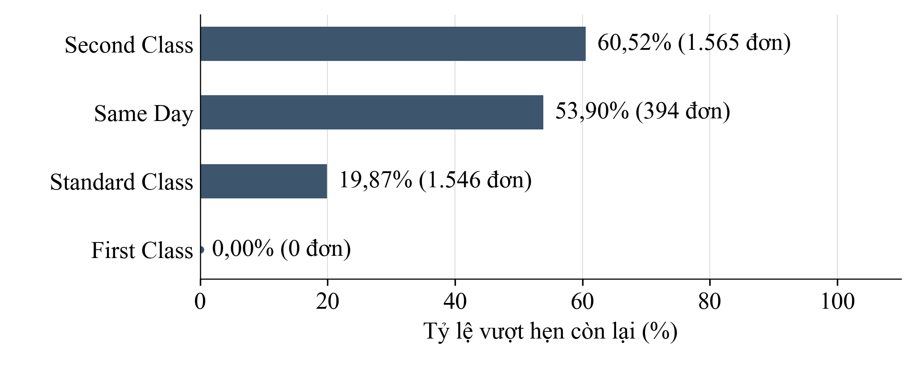
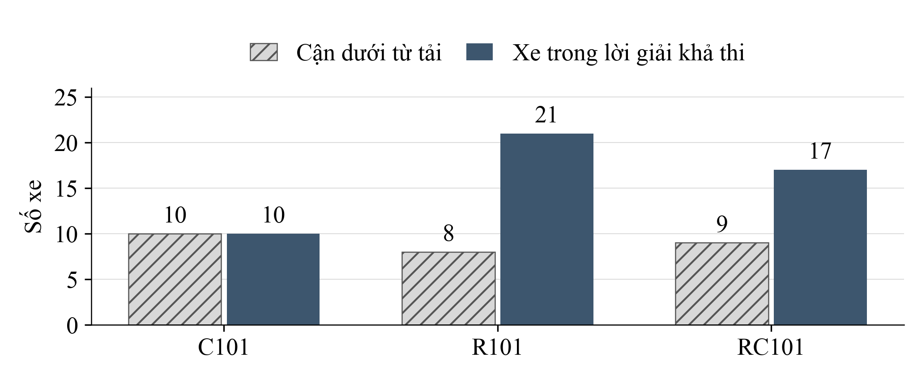

# 7.2 Hướng phát triển phân tích giao hàng và tối ưu đội xe

Kết quả ở Phần VI đặt ra ba hướng nghiên cứu tiếp theo cho Giám đốc Logistics, gồm kiểm chứng cam kết theo dịch vụ, ưu tiên cảnh báo theo nguồn lực và hoàn thiện quyết định số xe cùng thứ tự điểm dừng. Nghiên cứu đội xe tập trung vào số xe tối thiểu, mục tiêu chi phí và khả năng áp dụng cho một ngày giao thực tế. Mỗi hướng cần được kiểm chứng theo vấn đề còn lại trong kết quả hiện có.

## 7.2.1 Kiểm chứng cam kết theo từng dịch vụ

Trên 13.071 đơn test, phương án cộng tối đa một ngày và giữ Same Day bằng 0 làm tỷ lệ vượt hẹn tính lại giảm từ 57,56% xuống 26,82%. Cam kết trung bình tăng 0,94 ngày trong khi thời gian giao nguồn được giữ nguyên. Bảng 7.1 thể hiện sự khác biệt giữa các dịch vụ.

**Bảng 7.1 Kết quả hồi cứu của phương án cam kết giới hạn**

| Phương thức | Số đơn | Cam kết cũ → mới (ngày) | Vượt hẹn cũ (%) | Vượt hẹn mới (%) |
| --- | --- | --- | --- | --- |
| First Class | 1.974 | 1 → 2 | 100,00 | 0,00 |
| Same Day | 731 | 0 → 0 | 53,90 | 53,90 |
| Second Class | 2.586 | 2 → 3 | 80,55 | 60,52 |
| Standard Class | 7.780 | 4 → 5 | 39,50 | 19,87 |

Các tỷ lệ dùng số đơn của từng phương thức làm mẫu số.

Hình 7.1 dùng cùng tập test và kịch bản của Bảng 7.1. Nhãn cạnh thanh ghi tỷ lệ và số đơn vượt hẹn.

Second Class cần được ưu tiên nghiên cứu vì còn vượt hẹn 60,52%, tương ứng 1.565 đơn. Standard Class có tỷ lệ thấp hơn nhưng còn 1.546 đơn, gần bằng Second Class về khối lượng. Vì vậy, lựa chọn nhóm thí điểm cần xét đồng thời tỷ lệ và số đơn chịu ảnh hưởng. Same Day cần xác minh thời điểm khách thực nhận trước khi đề xuất cách giữ lời hứa giao trong ngày.

Nghiên cứu tiếp theo nên so sánh chính sách ứng viên với chính sách hiện hành trên đơn phát sinh sau khi chốt thiết kế. Nếu các đơn dùng chung xe hoặc nhân sự, có thể phân nhóm ngẫu nhiên theo ca hoặc khu vực để hạn chế ảnh hưởng giữa nhóm thử nghiệm và đối chứng. Theo dõi tỷ lệ vượt hẹn, thời gian giao thực, số ngày cam kết, hủy đơn và khiếu nại. Cỡ mẫu được xác định từ mức cải thiện cần phát hiện và đặc điểm phân nhóm. Quyết định mở rộng cần dựa trên khoảng tin cậy và mức đánh đổi thương mại đã thống nhất.

## 7.2.2 Phân bổ cảnh báo theo công suất và hiệu quả can thiệp

Baseline của TV4 tạo bốn mức xác suất theo phương thức. Tại ngưỡng 0,50, kết quả trên cùng 13.071 đơn test được tổng hợp ở Bảng 7.2.

**Bảng 7.2 Cảnh báo và kết quả thực tế trên tập test**

| Kết quả cảnh báo | Thực tế trễ | Thực tế không trễ | Tổng |
| --- | --- | --- | --- |
| Có cảnh báo | 4.057 | 503 | 4.560 |
| Không cảnh báo | 3.467 | 5.044 | 8.511 |
| Tổng | 7.524 | 5.547 | 13.071 |

Xác suất áp dụng cho cam kết cũ và mẫu không hủy trong dữ liệu lịch sử.

Precision đạt 88,97% nhưng recall đạt 53,92%, với 3.467 đơn trễ bị bỏ sót. Nghiên cứu tiếp theo cần xác định đội vận hành xử lý được bao nhiêu cảnh báo mỗi ngày, rồi đánh giá số đơn trễ tìm được trong giới hạn đó. Mô hình có khả năng xếp hạng trong từng phương thức có thể được so sánh trên giai đoạn validation và test mới, theo tiêu chí phù hợp công suất.

Hiệu quả xử lý cần được đo bằng thử nghiệm một hành động cụ thể, chẳng hạn rà soát đơn hoặc liên hệ điều phối sớm. Có thể dùng EVᵢ = pᵢ × eᵢ × Lᵢ − Cᵢ để đánh giá giá trị kỳ vọng. Trong đó pᵢ là xác suất vượt cam kết, eᵢ là tỷ lệ ngăn trễ khi can thiệp vào đơn vốn sẽ trễ, Lᵢ là tổn thất tránh được và Cᵢ là chi phí hành động. Hiệu quả can thiệp và chi phí cần được ước lượng từ thử nghiệm và kế toán. Khi đổi cam kết, xác suất pᵢ cũng cần được đánh giá lại theo lời hứa mới.

Đầu ra cần đạt là phương án ưu tiên vừa đáp ứng công suất vừa có bằng chứng về tác động. Thử nghiệm cần phân biệt ảnh hưởng của cảnh báo với ảnh hưởng của việc đổi cam kết. Nếu mở rộng sang mọi đơn mới, việc đánh giá phải bao quát quá trình hủy đơn từ thời điểm đặt hàng.

## 7.2.3 Hoàn thiện quyết định số xe và tuyến giao

Kết quả hiện tại đã trả lời chắc chắn bài toán số xe cho một cấu hình cụ thể. Với C101, sức chở Q = 200 và mỗi xe chạy một tuyến, tổng nhu cầu 1.810 đơn vị tạo cận dưới ceil(1.810 / 200) = 10 xe. Lời giải khả thi dùng đúng 10 xe đạt cận này. Các cấu hình khác còn khoảng cách giữa cận dưới tải và số xe đã tìm được, như Bảng 7.3.

**Bảng 7.3 Mức độ chứng minh số xe theo cấu hình**

| Instance và Q | Cận dưới tải | Xe khả thi | Số xe tối thiểu |
| --- | --- | --- | --- |
| C101 / 200 | 10 | 10 | Đã chứng minh |
| C101 / 160 | 12 | 13 | Chưa chứng minh |
| C101 / 240 | 8 | 10 | Chưa chứng minh |
| R101 / 200 | 8 | 21 | Chưa chứng minh |
| RC101 / 200 | 9 | 17 | Chưa chứng minh |

Q là sức chở theo đơn vị benchmark. Mỗi xe chạy một tuyến. C101 ở cấu hình K = 10, Q = 200 cho cùng kết luận 10 xe nên được trình bày chung với C101 / 200.

Hình 7.2 dùng cấu hình cơ sở có Q = 200 và tối đa 25 xe. Cận dưới chỉ xét tổng tải, còn lời giải khả thi đã được kiểm tra tải và khung giờ.

Hình 7.2 cho thấy số xe tối thiểu được xác định ở C101, còn R101 và RC101 cần nghiên cứu thêm. Khoảng cách giữa hai cột phụ thuộc cả chất lượng lời giải và độ chặt của cận dưới. Nghiên cứu cần cải thiện hai phía trước khi kết luận còn giảm được bao nhiêu xe. Quãng đường 828,94 đơn vị của lời giải C101 là một kết quả khả thi đã lưu.

**Ưu tiên mục tiêu và kiểm tra độ ổn định**

Lượt giải hiện tại tối thiểu hóa quãng đường dưới giới hạn số xe. Bước phát triển tiếp theo cần chốt mục tiêu nghiệp vụ. Khi ưu tiên đội xe, có thể tìm số xe khả thi nhỏ nhất rồi tối ưu quãng đường trong cấu hình đó. Khi ưu tiên tổng chi phí, cần bổ sung chi phí sử dụng xe và chi phí di chuyển vào hàm mục tiêu. Thứ tự mục tiêu phải được xác định trước khi so sánh kết quả.

Trên benchmark, nên mở rộng tập instance và chạy nhiều lần với ngân sách thời gian thống nhất. Mỗi lần chạy lưu số xe, quãng đường, thời gian tính và trạng thái khả thi. Kết quả cần được kiểm tra phục vụ đủ khách, sức chở, khung giờ và thời điểm về kho. Với R101 và RC101, có thể bổ sung đối chứng khả thi tốt hơn để đánh giá chất lượng tuyến. Cận dưới có xét khung giờ cũng giúp thu hẹp khoảng chưa xác định về số xe tối thiểu.

**Kiểm chứng trên ca giao thực tế**

Một đợt chạy song song có thể dùng cùng danh sách khách, đội xe và khung giờ để so tuyến do bộ giải lập với tuyến của điều phối viên. Đánh giá ban đầu xác nhận đủ điểm dừng và không vi phạm ràng buộc cứng. Tuyến đủ điều kiện sau đó được đưa vào thí điểm có giám sát để ghi nhận km đường bộ, thời gian phục vụ, số xe và nhiên liệu thực đo.

Mô hình có thể mở rộng sang xe nhiều loại, giới hạn thể tích, nhiều chuyến và thời gian đường bộ thay đổi theo giờ khi có dữ liệu tương ứng. Với nhiều chuyến, cần gắn từng chuyến vào lịch sử dụng xe. Khi đó, cận dưới từ tổng nhu cầu chia sức chở phải được xét lại theo lịch chuyến và số xe vật lý.

Đánh giá kinh tế cần tính chi phí ca xe, tài xế, làm thêm, giao lại và nhiên liệu. Chi phí cố định và chi phí theo tuyến phải được xác định riêng để tránh tính trùng lợi ích. Các phương án được so trên cùng yêu cầu phục vụ, đồng thời kiểm tra độ nhạy theo sản lượng và giá nhiên liệu. Đầu ra phục vụ quyết định là số xe, lịch tuyến, tổng chi phí và mức độ đáp ứng dịch vụ cho một ngày giao cụ thể.

**Nguồn của từng bảng và biểu đồ**

| Bảng hoặc hình | File nguồn | Dữ liệu sử dụng |
| --- | --- | --- |
| **Bảng 7.1 và Hình 7.1** | [pilot_by_mode_test.csv](https://github.com/AIVIETNAM-AIO-LeWann/dss-bi-delivery-analytics/blob/4e4fef27ef78499eb1eb891ab40e34d93aad71ed/workstreams/prescriptive/results/pilot_by_mode_test.csv) của TV5 | Số đơn, cam kết trước/sau và số đơn vượt hẹn theo phương thức |
| **Bảng 7.2** | [model_comparison.csv](https://github.com/AIVIETNAM-AIO-LeWann/dss-bi-delivery-analytics/blob/4e4fef27ef78499eb1eb891ab40e34d93aad71ed/workstreams/forecasting/results/model_comparison.csv) của Ngọc Quang | Dòng `mode_baseline`, tập `test`, ngưỡng `0.5`. Tổng hàng/cột được tính bằng mã |
| **Bảng 7.3 và Hình 7.2** | [fleet_sizing_bounds.csv](https://github.com/AIVIETNAM-AIO-LeWann/dss-bi-delivery-analytics/blob/4e4fef27ef78499eb1eb891ab40e34d93aad71ed/workstreams/prescriptive/results/fleet_sizing_bounds.csv) của TV5 | Cận dưới tải, số xe khả thi và trạng thái chứng minh số xe tối thiểu |
