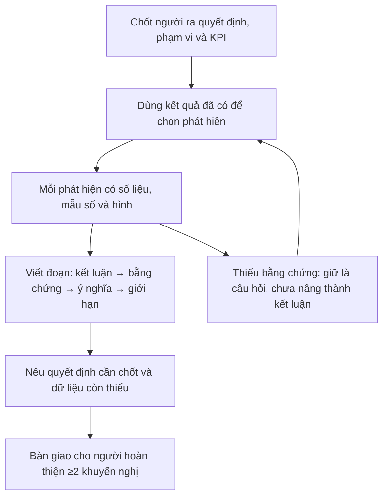
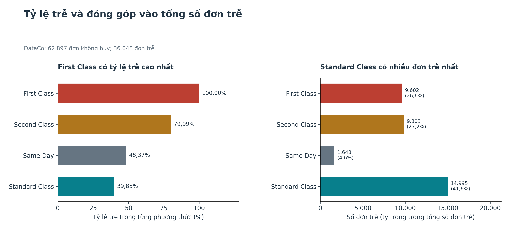
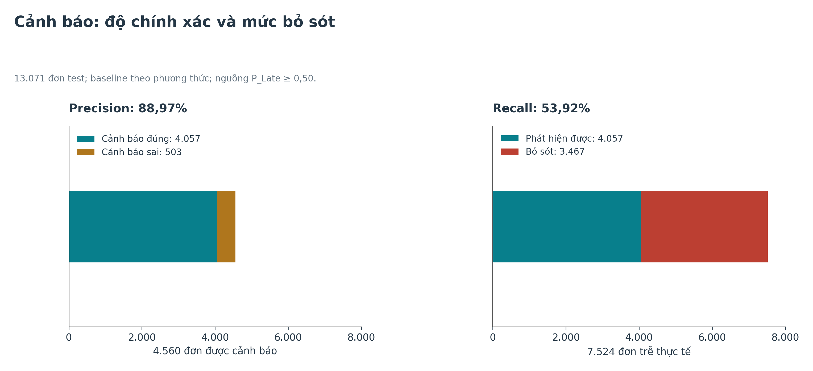
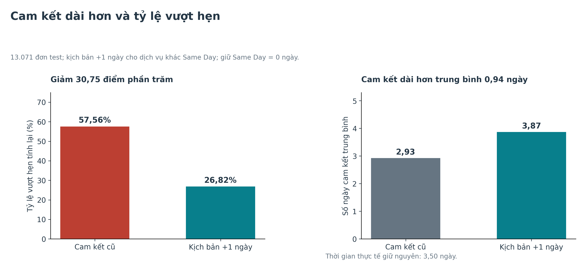
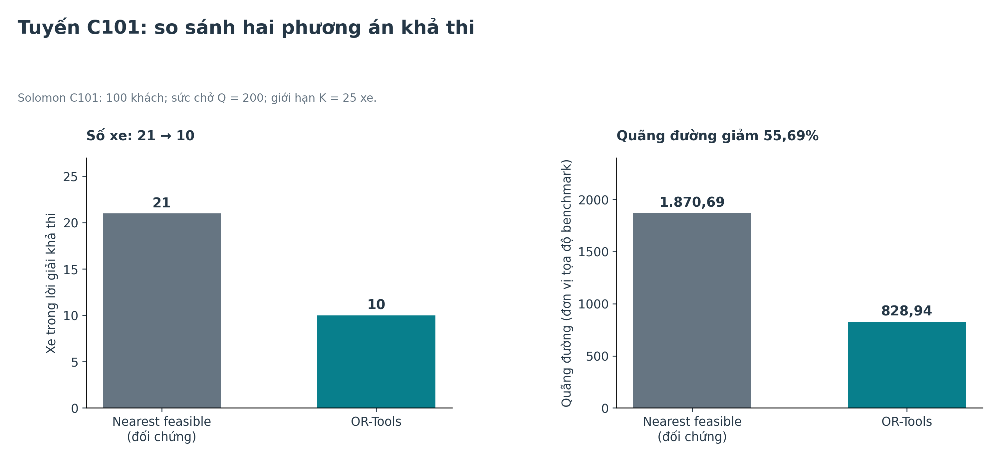

# Bàn giao kể chuyện dữ liệu và thông điệp chính — Phần VI

Ngày rà soát: 19/11/2026. Phạm vi nguồn: nhánh `main` tại commit `5548b18`, sau khi
các bộ mô tả, dự báo, đề xuất và Dashboard đã được tích hợp.

Tài liệu này thực hiện bước **chọn phát hiện quan trọng và nối kết quả với quyết
định**. Người nhận dùng khung đoạn văn, bằng chứng và hình bên dưới để hoàn thiện
thông điệp và ít nhất hai khuyến nghị có trực quan hóa hỗ trợ. Các câu về hành động
là câu hỏi cần chốt, chưa phải quyết định triển khai hoặc khuyến nghị cuối đã duyệt.

Cụm “quyết định HR” trong bảng phân công là phần còn sót của mẫu nhân sự. Với chủ
đề 18, người nhận báo cáo là **Giám đốc Logistics**; các quyết định liên quan đến
cam kết giao hàng, ưu tiên xử lý cảnh báo và phương án tuyến. DHL chỉ là bối cảnh
tham chiếu của nhóm; DataCo/Solomon không được gọi là dữ liệu vận hành DHL.

## 1. Luồng làm việc để viết tiếp



Người viết làm lần lượt theo sáu việc sau. Mỗi việc có đầu ra để kiểm tra trước
khi chuyển bước; không cần chạy lại các phân tích đã bàn giao để bắt đầu viết.

1. **Chốt câu hỏi:** Giám đốc Logistics cần ưu tiên rà soát dịch vụ nào, cân nhắc
   cam kết giao hàng ra sao, và dùng cảnh báo/tuyến ở mức nào? Chưa có ngân sách,
   năng lực xử lý cảnh báo/ngày hoặc mức dịch vụ được quản lý duyệt.
2. **Khóa mẫu số:** mô tả trên 62.897 đơn không hủy; dự báo và chính sách trên cùng
   13.071 đơn test; tuyến trên Solomon C101 có 100 khách. Ghi các phạm vi này ngay
   cạnh số, không nối tuyến Solomon với các đơn DataCo.
3. **Chọn phát hiện:** dùng F1–F3 làm mạch DataCo; F4 là nhánh riêng cho quyết định
   tuyến. Con số trễ tổng thể chỉ mở bối cảnh, không đứng một mình như khuyến nghị.
4. **Viết một đoạn cho một ý:** theo P0–P4 bên dưới. Mỗi đoạn có một câu đầu nêu
   điểm chính, bằng chứng hỗ trợ và một câu chuyển sang câu hỏi tiếp theo.
5. **Nối với quyết định:** điền lựa chọn, KPI, điều kiện và bằng chứng còn thiếu
   trong mục 5. Không suy từ tương quan sang tác động can thiệp.
6. **Bàn giao:** gửi tài liệu này, bộ hình PNG/SVG và đường dẫn bảng nguồn. Người
   sau chốt ít nhất hai khuyến nghị, kiểm tra câu chữ và chọn hình đưa vào báo cáo.

## 2. Dàn ý đoạn văn và thứ tự hình

- **P0 — Mở bối cảnh:** quy mô giao trễ và phạm vi dữ liệu.
- **P1 — Phát hiện F1:** ưu tiên theo tỷ lệ trễ và khối lượng trễ là hai lựa chọn khác nhau.
- **P2 — Phát hiện F2:** cảnh báo theo nhóm hỗ trợ được gì và bỏ sót gì.
- **P3 — Phát hiện F3:** đổi cam kết có đánh đổi; chưa chứng minh giao nhanh hơn.
- **P4 — Phát hiện F4:** phương án tuyến có bằng chứng benchmark riêng.
- **P5 — Chuyển cho người sau:** từ các lựa chọn còn mở đến ít nhất hai khuyến nghị có điều kiện.

Giữ F1–F3 nếu phần viết chỉ phụ trách câu chuyện DataCo. Nếu phần VI trình bày đầy
đủ cả giao đúng hẹn và tối ưu tuyến của chủ đề 18, thêm F4 với câu chuyển nguồn rõ
ràng. Không gộp hai nguồn thành một kết quả tiết kiệm cho doanh nghiệp.

## 3. Nội dung bàn giao theo từng đoạn

### P0 — Mở bối cảnh: vấn đề lớn đến đâu?

**Vai trò đoạn:** opening/evidence. **Mẫu số:** 62.897 đơn không hủy.

Đoạn gợi ý:

> Trong mẫu 62.897 đơn không hủy, 36.048 đơn có nhãn giao trễ, tương ứng 57,31%.
> Con số này cho thấy quy mô vượt cam kết trong bộ dữ liệu lịch sử, nhưng chưa
> chỉ ra nhóm nào cần được ưu tiên. Để hỗ trợ quyết định phân bổ sự chú ý của
> Giám đốc Logistics, cần xét cả tỷ lệ trễ của từng nhóm và số đơn trễ mà nhóm đó
> đóng góp vào tổng thể.

**Nguồn:** [baseline_kpis.csv](../../reports/data_quality/baseline_kpis.csv),
dòng `order/non_canceled_valid`. Tỷ lệ trên toàn bộ 65.752 đơn là 54,82%, có hủy=0;
không thay số đó vào đoạn này. Các trạng thái không hủy không đồng nghĩa đã có
thời điểm khách nhận hàng được xác thực độc lập.

**Đầu ra bước này:** người nhận biết phạm vi và câu hỏi ưu tiên, chưa nhận một
kết luận về nguyên nhân hay khoản thiệt hại tài chính.

### P1 / F1 — Nhóm nào cần ưu tiên theo mục tiêu nào?

**Vai trò đoạn:** evidence/interpretation. **Thông điệp cần giữ:** First Class nổi
bật về tỷ lệ trễ; Standard Class nổi bật về đóng góp số đơn trễ. Cả hai đều đáng
được xem xét, nhưng phục vụ các mục tiêu ưu tiên khác nhau.



Đoạn gợi ý:

> Ưu tiên theo tỷ lệ trễ và ưu tiên theo số đơn bị ảnh hưởng dẫn đến hai nhóm
> khác nhau. First Class có 9.602/9.602 đơn trễ, với cam kết một ngày và số ngày
> thực tế ghi nhận đều bằng hai. Standard Class có tỷ lệ trễ thấp hơn, 39,85%,
> nhưng đóng góp 14.995 đơn, chiếm 41,60% tổng số đơn trễ. Vì vậy, dữ liệu đặt ra
> hai hướng rà soát: tính phù hợp của cam kết First Class và quy mô vấn đề ở
> Standard Class. Sau khi xác định nhóm cần chú ý, câu hỏi tiếp theo là hệ thống
> cảnh báo có giúp nhận diện rủi ro trước khi giao hay không.

**Quyết định được hỗ trợ:** nếu ưu tiên rà soát mức độ giữ lời hứa của dịch vụ,
bắt đầu xem First Class và Second Class; nếu ưu tiên số đơn có thể bị ảnh hưởng,
đánh giá thêm Standard Class. Chưa có ước lượng tác động hoặc chi phí can thiệp
để kết luận nhóm nào phải nhận ngân sách trước.

**Bằng chứng:** [bảng phương thức TV3](../../workstreams/descriptive/tables/01_shipping_mode_detailed.csv).
Kiểm định [chi-bình phương và Cramér's V](../../workstreams/descriptive/tables/11_chi2_independence_tests.csv)
cho thấy liên hệ theo phương thức có V=0,4807; thị trường có V=0,0071, p=0,5289.
Đây là kết quả kiểm định trong mẫu, không chứng minh quan hệ nhân quả hoặc địa lý
không bao giờ quan trọng. Không diễn giải p>0,05 thành “hoàn toàn độc lập”.

**Trực quan sẵn có:** Dashboard trang Tổng quan (`#p1`), bỏ lọc phương thức/thị
trường/vùng. Hình 1 bổ sung hai góc nhìn tỷ lệ và khối lượng trong cùng khung.

**Giới hạn phải đi cùng:** First Class trễ 100% là đặc tính bản dữ liệu; chưa bảo
đảm kết quả ngoài mẫu thực tế. Số đơn trễ lớn không đồng nghĩa lượng trễ có thể
giảm được lớn nếu chưa có bằng chứng tác động của giải pháp.

### P2 / F2 — Cảnh báo hỗ trợ quyết định đến mức nào?

**Vai trò đoạn:** evidence/limitation. **Mẫu số:** 13.071 đơn test; ngưỡng 0,50.



Đoạn gợi ý:

> Cảnh báo ở ngưỡng 0,50 có độ chính xác cao trong tập test nhưng còn bỏ sót nhiều
> đơn trễ. Trong 4.560 cảnh báo, 4.057 là đúng và 503 là sai, cho precision 88,97%.
> Tuy nhiên, chỉ 4.057/7.524 đơn trễ thực tế được phát hiện, tương ứng recall
> 53,92%; còn 3.467 đơn bị bỏ sót. Mô hình được chọn là baseline theo phương thức,
> nên các đơn cùng phương thức nhận cùng một điểm rủi ro. Kết quả phù hợp để thảo
> luận mức cảnh báo theo nhóm, trong khi việc chọn ngưỡng vận hành cần thêm năng
> lực xử lý và chi phí sai sót. Cảnh báo cũng chưa giải quyết câu hỏi cam kết thời
> gian nào phù hợp với khả năng giao hàng.

**Quyết định được hỗ trợ:** chấp nhận xử lý khoảng 34,89% số đơn test như cảnh báo
ở ngưỡng này, hay cân nhắc ngưỡng khác theo nguồn lực? Tỷ lệ 34,89% là tỷ trọng
trong test, không phải số cảnh báo/ngày của doanh nghiệp. Không giả định thêm nhân
sự hoặc đổi ngưỡng chắc chắn làm giảm trễ khi chưa có thử nghiệm can thiệp.

**Bằng chứng:** [model_comparison.csv](../../workstreams/forecasting/results/model_comparison.csv),
dòng `mode_baseline/test`; [model_selection.json](../../workstreams/forecasting/results/model_selection.json)
cho biết chọn theo log loss validation thấp nhất, không chọn bằng test.
[mode_baseline_train.csv](../../workstreams/forecasting/results/mode_baseline_train.csv)
giải thích bốn mức rủi ro. Không viết mô hình phức tạp “tốt hơn baseline” chỉ vì
một metric khác cao hơn, khi tiêu chí chọn đã chốt là log loss validation.

**Trực quan:** Dashboard trang Rủi ro (`#p2`), toàn bộ test, ngưỡng 0,50. Hình 2
giữ hai mẫu số riêng để tránh nhầm precision với recall.

**Giới hạn phải đi cùng:** P_Late theo cam kết cũ, có điều kiện không hủy; chưa
xếp hạng riêng các đơn cùng phương thức hoặc xác thực khả năng vận hành trên mọi
đơn mới. Nếu lọc lại Dashboard hoặc đổi ngưỡng, phải cập nhật số trong đoạn.

### P3 / F3 — Đổi cam kết có lợi ích và đánh đổi gì?

**Vai trò đoạn:** evidence/trade-off. **Mẫu số:** cùng 13.071 đơn test của P2.



Đoạn gợi ý:

> Điều chỉnh cam kết làm giảm tỷ lệ vượt hẹn tính lại, đồng thời kéo dài thời hạn
> đã hứa với khách. Trong kịch bản cộng một ngày cho các dịch vụ khác Same Day,
> tỷ lệ vượt hẹn trên tập test giảm từ 57,56% xuống 26,82%, tương ứng 30,75 điểm
> phần trăm. Số ngày cam kết trung bình tăng từ 2,93 lên 3,87, trong khi số ngày
> thực tế giữ nguyên ở khoảng 3,50. Riêng Second Class vẫn vượt hẹn 60,52%, cho
> thấy cần xem kết quả theo dịch vụ trước khi chốt áp dụng chung. Quyết định vì
> vậy cần xét mức cam kết có thể chấp nhận cùng kết quả giữ lời hứa, thay vì chỉ
> nhìn mức giảm của tỷ lệ vượt hẹn.

**Quyết định được hỗ trợ:** có đưa phương án giới hạn +1 ngày sang đánh giá/thí
điểm theo dịch vụ không, và có giữ Same Day=0 không? Chưa có mục tiêu dịch vụ,
giới hạn thương mại hay chi phí khách chờ được duyệt để chốt lựa chọn cuối.

**Bằng chứng:** [promise_summary.csv](../../workstreams/prescriptive/results/promise_summary.csv),
`current/test` và `bounded_plus1_keep_same_day/test`;
[pilot_by_mode_test.csv](../../workstreams/prescriptive/results/pilot_by_mode_test.csv)
cho phép kiểm tra phần Second Class. Mức 57,31% ở P0 là toàn mẫu analysis, còn
57,56% ở đây là test: phải ghi rõ khi chuyển đoạn.

**Trực quan:** Dashboard Cam kết (`#p3`), không lọc nhóm, phương án
`bounded_plus1_keep_same_day`. Hình 3 cho thấy đồng thời tỷ lệ vượt hẹn và độ dài
cam kết; không để người đọc hiểu +0,94 ngày là thời gian thực nhận tăng.

**Giới hạn phải đi cùng:** kết quả hồi cứu giữ duration thực tế cố định; chưa
chứng minh giao nhanh hơn, cải thiện hài lòng hoặc tiết kiệm chi phí. P_Late cũ
không phải xác suất vượt cam kết mới. Không chọn chính sách bằng hiệu quả test
sau khi đã xem test rồi báo đó là một đánh giá triển khai độc lập.

### P4 / F4 — Phương án tuyến có bằng chứng riêng nào?

**Vai trò đoạn:** scope transition/evidence. Đoạn này chuyển từ DataCo sang
benchmark Solomon; dùng nếu báo cáo tổng hợp bao gồm mục tiêu tối ưu tuyến.



Đoạn gợi ý:

> Bài toán tuyến được đánh giá riêng trên benchmark Solomon vì DataCo không có
> đầy đủ đầu vào điểm dừng và xe. Với C101, sức chở 200 và giới hạn 25 xe,
> OR-Tools tìm được lời giải khả thi dùng 10 xe và 828,94 đơn vị tọa độ, so với
> 21 xe và 1.870,69 đơn vị của đối chứng nearest feasible. Quãng đường thấp hơn
> 55,69% so với chính đối chứng đã triển khai. Số xe 10 đạt cận dưới tải của cấu
> hình này, nhưng quãng đường chưa được chứng minh tối ưu. Kết quả cung cấp một
> phương án để kiểm tra nghiệp vụ tuyến, chưa xác nhận mức tiết kiệm của DataCo
> hoặc doanh nghiệp dùng làm bối cảnh.

**Quyết định được hỗ trợ:** có đưa lời giải tuyến khả thi sang bước kiểm tra
nghiệp vụ với điểm giao, xe, thời gian đường bộ và chi phí thật không? Không gộp
phần trăm quãng đường này với phần trăm vượt hẹn DataCo thành hiệu quả chung.

**Bằng chứng:** [routing_summary.csv](../../workstreams/prescriptive/results/routing_summary.csv),
`c101/base`, hai phương pháp; [fleet_sizing_bounds.csv](../../workstreams/prescriptive/results/fleet_sizing_bounds.csv)
và [verification.json](../../workstreams/prescriptive/results/verification.json).
Tổng nhu cầu 1.810, Q=200: cận dưới `ceil(1810/200)=10`, bằng số xe khả thi.

**Trực quan:** Dashboard Tuyến (`#p4`), C101/base, cùng Q=200 và K=25. Bổ sung sơ
đồ tuyến [C101 OR-Tools](../../workstreams/prescriptive/figures/c101_ortools.png)
nếu cần minh họa điểm dừng; Hình 4 hỗ trợ so sánh định lượng.

**Giới hạn phải đi cùng:** đơn vị tọa độ không phải km; đối chứng tham lam còn
hạn chế; chưa có ROI thực. R101/RC101 không có đối chứng khả thi trong kết quả
bàn giao nên không tính phần trăm tiết kiệm như C101.

## 4. Đọc ngược mạch lập luận trước khi bàn giao

Đọc chỉ câu đầu của P0–P4, rồi đối chiếu chuỗi ý sau:

> Quy mô vượt hẹn lớn → có hai cách xác định nhóm ưu tiên → cảnh báo hỗ trợ ở mức
> nhóm nhưng còn bỏ sót → đổi cam kết có đánh đổi cần chốt → tuyến cần bằng chứng
> benchmark độc lập trước khi kiểm tra nghiệp vụ thực tế.

Nếu một đoạn không giúp người đọc tiến tới một quyết định trong chuỗi trên,
chuyển nó sang phụ lục hoặc bỏ khỏi phần thông điệp chính. Bảng tỷ lệ thiếu,
encoding và lịch sử làm sạch phục vụ độ tin cậy dữ liệu; không cần lặp toàn bộ
trong phần kể chuyện kết quả.

**Câu kết nối P5 để người sau viết tiếp:**

> Các kết quả trên cung cấp căn cứ để nhóm chốt ưu tiên rà soát cam kết dịch vụ,
> cách sử dụng cảnh báo và điều kiện kiểm tra phương án tuyến. Phần tiếp theo
> chuyển các lựa chọn này thành khuyến nghị có người thực hiện, tiêu chí đánh giá
> và điều kiện kiểm chứng, đồng thời giữ rõ các giới hạn của dữ liệu lịch sử.

## 5. Cầu nối từ phát hiện tới quyết định cho người nhận

Mỗi mục dưới đây là đầu vào để người sau hoàn thiện khuyến nghị. Chưa thay bằng
mệnh lệnh triển khai hoặc một mức ngân sách không có nguồn.

- **F1 — Ưu tiên nhóm:** lựa chọn giữa rà soát tính phù hợp cam kết của First/Second
  Class và đánh giá khối lượng ảnh hưởng của Standard Class. KPI: tỷ lệ trễ cùng
  số đơn trễ; hình: 1. Cần bổ sung năng lực, chi phí và tác động kỳ vọng của từng
  hành động nếu phân bổ ngân sách. Không suy khối lượng thành số đơn chắc chắn giảm.
- **F2 — Ngưỡng cảnh báo:** cân nhắc cảnh báo theo nguồn lực/ngày và chi phí bỏ sót,
  cảnh báo sai. KPI: số cảnh báo, precision, recall, bỏ sót; hình: 2. Cần có năng
  lực và ma trận chi phí; ngưỡng 0,50 hiện là mốc đánh giá, chưa tối ưu kinh doanh.
- **F3 — Cam kết:** xem phương án giới hạn +1 ngày theo dịch vụ và cách giữ Same
  Day. KPI: vượt hẹn tính lại, ngày cam kết và duration thực; hình: 3. Cần mục tiêu
  dịch vụ, giới hạn thương mại và thiết kế pilot; kết quả Second Class chưa giải
  quyết bằng chính sách này nên phải xuất hiện trong phần điều kiện.
- **F4 — Tuyến:** cân nhắc lời giải khả thi so với đối chứng trên cùng cấu hình.
  KPI: đủ khách, vi phạm tải/khung giờ, xe và quãng đường đúng đơn vị; hình: 4 và sơ
  đồ tuyến. Cần dữ liệu vận hành thực trước khi nói đến lợi ích doanh nghiệp.

Mẫu để người nhận viết từng khuyến nghị sau khi chốt lựa chọn:

```text
Từ phát hiện F__, nhóm đề xuất [hành động] cho [nhóm/phạm vi],
vì [số liệu có mẫu số] ở Hình __ cho thấy [diễn giải có giới hạn].
Việc áp dụng cần [điều kiện/nguồn lực chưa có]; đánh giá bằng [KPI và đối chứng].
Không suy rộng kết quả thành [tác động mà dữ liệu chưa chứng minh].
```

Chọn ít nhất hai hướng có hành động phân biệt và bằng chứng riêng. Ví dụ F2 và
F3 là hai quyết định khác nhau; tách First Class và Standard Class thành hai câu
giống nhau chưa chắc tạo thành hai khuyến nghị độc lập. Nếu cả mục tiêu tuyến nằm
trong phạm vi báo cáo, giữ thêm F4 dù chỉ trình bày ở phần riêng.

## 6. Bản đồ kết luận — bằng chứng — trạng thái

- **Claim F1:** nhóm có tỷ lệ trễ cao nhất khác nhóm đóng góp nhiều đơn trễ nhất.
  **Evidence:** TV3 bảng phương thức, baseline TV2, Hình 1.
  **Status: supported** trong mẫu 62.897 đơn; tác động của can thiệp **needs evidence**.
- **Claim F2:** ở ngưỡng 0,50, 4.560 cảnh báo đạt precision 88,97% nhưng recall
  53,92% trên test. **Evidence:** TV4 model_comparison và mode_baseline_train, Hình 2.
  **Status: supported** cho dự báo theo nhóm/cam kết cũ; ngưỡng kinh doanh và hiệu
  quả vận hành **needs evidence**.
- **Claim F3:** cộng ngày cam kết làm giảm vượt hẹn tính lại 30,75 điểm phần trăm,
  thêm trung bình 0,94 ngày cam kết. **Evidence:** TV5 promise_summary và pilot_by_mode_test,
  Hình 3. **Status: supported** cho mô phỏng hồi cứu; giao nhanh hơn, hài lòng hoặc
  ROI thực **needs evidence**.
- **Claim F4:** C101/base có lời giải khả thi 10 xe, 828,94 đơn vị; quãng đường
  thấp hơn đối chứng 55,69%. **Evidence:** TV5 routing_summary, fleet_sizing_bounds
  và verification, Hình 4. **Status: supported** trên cấu hình benchmark; tối ưu
  quãng đường và tiết kiệm thực DataCo/DHL **needs evidence**.

## 7. Tự rà soát và việc còn lại khi nhận bàn giao

1. **Đóng góp của phần viết là gì?** Nối kết quả các thành viên thành các lựa chọn
   cho người ra quyết định; không tuyên bố thuật toán mới. **Đạt** ở bản bàn giao.
2. **Mạch viết và thuật ngữ có rõ không?** Mỗi đoạn một ý, định nghĩa mẫu trước
   số; precision khác recall, thêm ngày cam kết khác thêm thời gian thực nhận.
   **Đạt** ở cấu trúc gợi ý; người sau giữ nguyên phân biệt khi biên tập.
3. **Bằng chứng có đủ mạnh cho câu chữ không?** Các số được đối chiếu giữa bảng
   tổng hợp; không chạy lại huấn luyện hoặc bộ giải trong đợt này. **Đạt cho mô tả
   kết quả bàn giao**; hiệu quả nhân quả/triển khai cần dữ liệu mới.
4. **Đánh giá có thiếu gì?** Chưa có năng lực/ngày, ma trận chi phí, SLA được duyệt
   hoặc tác động pilot. **Cần bổ sung trước khi chốt triển khai**; không tự điền
   các tham số này để đủ phần khuyến nghị.
5. **Thiết kế có đúng phạm vi không?** Tách mẫu không hủy, test và Solomon; model
   chỉ có bốn mức điểm; các phương án chính sách phải xét cùng điều kiện.
   **Đạt ở bản bàn giao**, còn khả năng chuyển sang hệ thống thực chưa xác minh.

Người nhận hoàn thiện ≥2 khuyến nghị, tên người thực hiện, điều kiện áp dụng và
KPI đánh giá; chọn hình/caption; sau đó ghép với
[nháp phần VI hiện có](section_vi_dashboard.md). Cần xóa hoặc cập nhật các câu
trùng, giữ mẫu số cạnh số liệu và rà thứ tự hình khi đưa sang Word/slide.

## 8. Tái tạo bằng chứng và hình

Các hình vẽ bằng Matplotlib từ bảng nguồn trong Git, không dùng ảnh số liệu giả.
PNG dùng để chèn báo cáo; SVG dùng khi cần đổi kích thước. Cả hai cùng dữ liệu và
có checksum tại [figure_manifest.json](../../reports/storytelling/figure_manifest.json).
Theo yêu cầu trình bày, hình chỉ có tiêu đề, mẫu số/phạm vi, đơn vị, số liệu và
chú giải; nguồn, giới hạn và nội dung diễn giải được đặt trong tài liệu này.

```powershell
.venv/Scripts/python -m pip install -e ".[storytelling]"
.venv/Scripts/python scripts/build_storytelling_evidence.py
.venv/Scripts/python scripts/build_storytelling_figures.py
.venv/Scripts/python scripts/build_storytelling_evidence.py --check
```

[evidence.json](../../reports/storytelling/evidence.json) ghi công thức kết quả,
mẫu số và checksum các bảng nguồn. Bộ kiểm tra đối chiếu số đếm, metric và cấu
hình giữa các bảng tổng hợp; không thay thế kiểm tra khóa đơn hoặc nghiệm thu
Dashboard trong trình duyệt/Power BI. Khi đầu vào thay đổi, tính lại bằng chứng,
vẽ lại hình và sửa các đoạn số liệu ở tài liệu này trước khi bàn giao lại.
