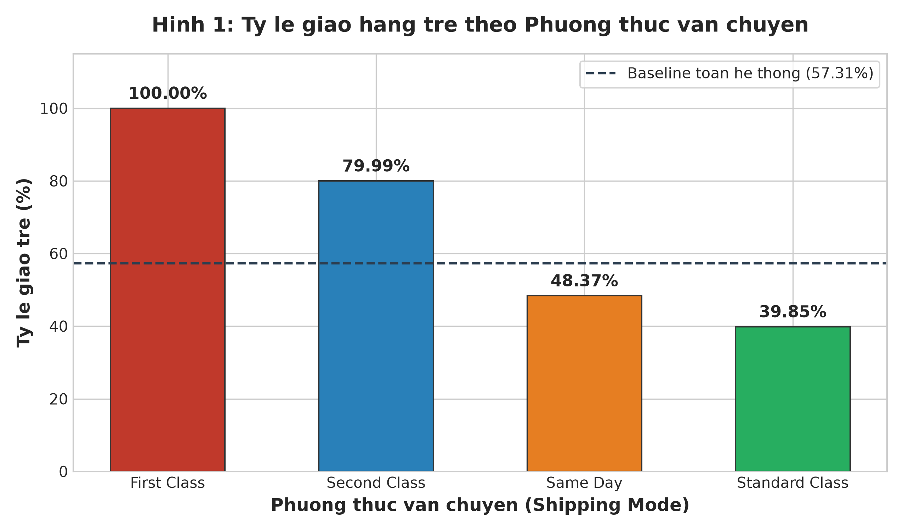
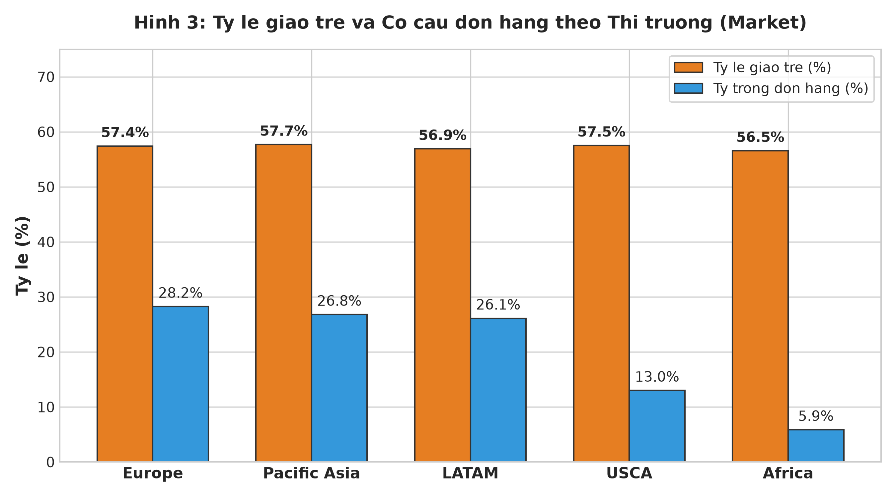
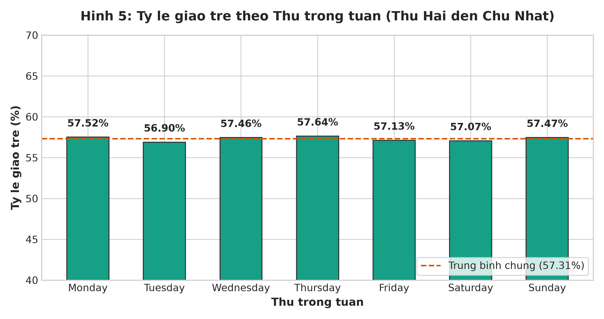
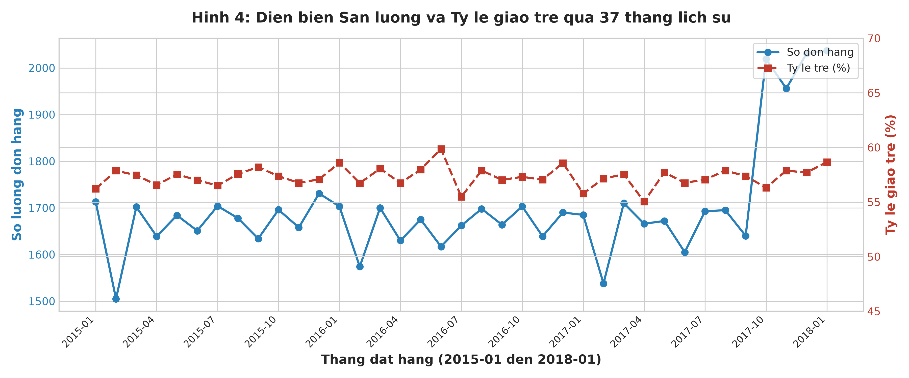
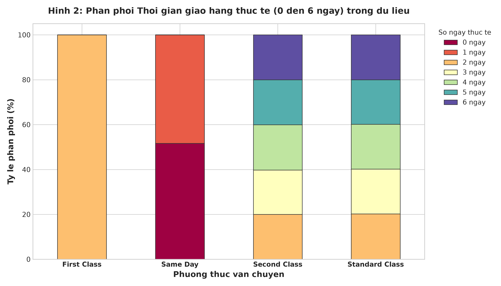
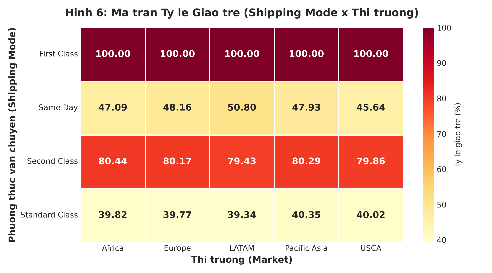

# BÁO CÁO PHÂN TÍCH MÔ TẢ VÀ CHẨN ĐOÁN
**Chủ đề 18: Giao hàng đúng hẹn và tối ưu tuyến đường (Delivery Performance & Route Optimization)**  
**Thành viên phụ trách:** Hoàng Quân (TV3 — Phân tích mô tả & chẩn đoán | Hạn hoàn thành: 05/11/2026)  
**Tập dữ liệu sử dụng:** `orders_analysis.csv` ($N = 62.897$ đơn hàng) & `order_items_clean.csv` ($N = 180.519$ dòng hàng) do Lê Quang (TV2) bàn giao.  
**Nhiệm vụ theo bảng phân công công việc:**
1. Phân tích giao trễ (`late_delivery_risk`) tổng thể và theo các nhóm đơn hàng.
2. Xác định các yếu tố/nhóm có liên hệ với rủi ro giao trễ.
3. Thực hiện các phân tích thống kê phù hợp.
4. Rút ra các nhóm rủi ro đáng chú ý.

*(Ghi chú phân công: Tập trung trả lời "đang xảy ra gì?" và "có yếu tố/nhóm nào đáng chú ý?". Không suy luận, không đưa ra các kịch bản giả định hay đề xuất chính sách).*

---

## 1. PHÂN TÍCH GIAO TRỄ TỔNG THỂ VÀ THEO CÁC NHÓM ĐƠN HÀNG

### 1.1. Tỷ lệ Giao trễ Tổng thể & Phân tích Độ nhạy (Sensitivity Analysis)

Trên tập dữ liệu phân tích chuẩn hóa `orders_analysis.csv` ($N = 62.897$ đơn hàng hợp lệ sau khi loại trừ $2.855$ đơn hủy theo quy chuẩn TV2):
- **Số đơn giao trễ (`late_delivery_risk = 1`):** **36.048 đơn**.
- **Số đơn đúng hẹn (`late_delivery_risk = 0`):** **26.849 đơn**.
- **Tỷ lệ giao trễ cơ sở (Baseline Late Rate):** **57,31%**.
- **Thời gian cam kết bình quân:** **2,94 ngày**.
- **Thời gian giao thực tế bình quân:** **3,50 ngày** (Độ lệch chuẩn: **1,62 ngày**).
- **Độ lệch giao hàng trung bình (`delay_days = actual - scheduled`):** **+0,57 ngày**.

#### Bảng 1.1: Phân tích độ nhạy trên các định nghĩa mẫu (Tham chiếu: `tables/00_overview_baseline_kpis.csv`)

| Tập mẫu đối chiếu | File dữ liệu nguồn | Tổng số đơn | Số đơn trễ | Tỷ lệ trễ (%) | Cam kết TB | Thực tế TB | Độ trễ TB |
| :--- | :--- | :---: | :---: | :---: | :---: | :---: | :---: |
| **primary_analysis_cohort** | `orders_analysis.csv` | 62.897 | 36.048 | **57,31%** | 2,94 | 3,50 | +0,57 |
| **all_source_orders** | `orders_clean.csv` (gồm cả 2.855 đơn hủy) | 65.752 | 36.048 | **54,82%** | 2,93 | 3,50 | +0,57 |
| **complete_and_closed_orders** | `orders_clean.csv (trạng thái COMPLETE, CLOSED)` | 28.965 | 16.633 | **57,42%** | 2,93 | 3,49 | +0,56 |
| **without_first_class** | `orders_analysis.csv (loại bỏ First Class)` | 53.295 | 26.446 | **49,62%** | 3,28 | 3,77 | +0,49 |
| **timestamp_consistent_subset** | `orders_analysis.csv (duration_mismatch_flag == 0)` | 59.490 | 34.400 | **57,82%** | 3,10 | 3,67 | +0,57 |

*Nhận xét:* Tỷ lệ trễ duy trì quanh ngưỡng **57,3% – 57,8%** ngay cả khi chỉ xét riêng đơn hàng đã hoàn tất dòng tiền (`COMPLETE` & `CLOSED`).

---

### 1.2. Phân tích theo Phương thức Vận chuyển (`shipping_mode`)

#### Bảng 1.2: Hiệu suất giao hàng theo Phương thức vận chuyển (Tham chiếu: `tables/01_shipping_mode_detailed.csv`)

| Phương thức vận chuyển | Số đơn | Cơ cấu (%) | Số đơn trễ | Tỷ lệ trễ (%) | Cam kết TB | Thực tế TB | Độ lệch chuẩn (SD) | P50 | P90 |
| :--- | :---: | :---: | :---: | :---: | :---: | :---: | :---: | :---: | :---: |
| **First Class** | 9.602 | 15,27% | 9.602 | **100,00%** | 1,00 ngày | 2,00 ngày | 0,00 ngày | 2,0 | 2,0 |
| **Second Class** | 12.256 | 19,49% | 9.803 | **79,99%** | 2,00 ngày | 4,00 ngày | 1,41 ngày | 4,0 | 6,0 |
| **Same Day** | 3.407 | 5,42% | 1.648 | **48,37%** | 0,00 ngày | 0,48 ngày | 0,50 ngày | 0,0 | 1,0 |
| **Standard Class** | 37.632 | 59,83% | 14.995 | **39,85%** | 4,00 ngày | 3,99 ngày | 1,42 ngày | 4,0 | 6,0 |
| **Toàn hệ thống** | **62.897** | **100,00%** | **36.048** | **57,31%** | **2,94 ngày** | **3,50 ngày** | **1,62 ngày** | **3,0** | **6,0** |

#### Các điểm dị thường nổi bật từ số liệu:
1. **First Class (100,00% trễ):** Toàn bộ **9.602 đơn First Class** đều bị trễ. Trong dữ liệu, cam kết hệ thống luôn là 1 ngày, nhưng thời gian thực tế ghi nhận luôn là đúng 2 ngày ($\text{SD} = 0,00$).
2. **Second Class (79,99% trễ):** Gần 4/5 số đơn bị trễ ($9.803 / 12.256$ đơn). Cam kết là 2 ngày nhưng thời gian thực tế trung bình là 4,00 ngày.
3. **Same Day (48,37% trễ):** Cam kết là 0 ngày nhưng có 1.648 đơn mất 1 ngày.
4. **Standard Class (39,85% trễ):** Chiếm gần 60% tổng lượng đơn (37.632 đơn) với tỷ lệ trễ thấp nhất trong 4 phương thức.

---

### 1.3. Phân tích theo Thị trường & Vùng địa lý

#### Bảng 1.3: Hiệu suất giao hàng theo Thị trường (Tham chiếu: `tables/03_market_performance.csv`)

| Thị trường (`market`) | Số đơn hàng | Cơ cấu (%) | Số đơn trễ | Tỷ lệ trễ (%) | Cam kết TB | Thực tế TB | Độ lệch TB |
| :--- | :---: | :---: | :---: | :---: | :---: | :---: | :---: |
| **Europe** | 17.763 | 28,24% | 10.199 | **57,42%** | 2,93 ngày | 3,50 ngày | +0,56 ngày |
| **Pacific Asia** | 16.853 | 26,79% | 9.720 | **57,68%** | 2,93 ngày | 3,51 ngày | +0,58 ngày |
| **LATAM** | 16.414 | 26,10% | 9.339 | **56,90%** | 2,95 ngày | 3,50 ngày | +0,55 ngày |
| **USCA** | 8.178 | 13,00% | 4.704 | **57,52%** | 2,92 ngày | 3,50 ngày | +0,58 ngày |
| **Africa** | 3.689 | 5,87% | 2.086 | **56,55%** | 2,95 ngày | 3,50 ngày | +0,55 ngày |

*Nhận xét số liệu:* Tỷ lệ trễ giữa 5 thị trường gần như bằng nhau (dao động trong khoảng rất hẹp từ 56,55% ở Africa đến 57,68% ở Pacific Asia; thời gian thực tế trung bình đều xấp xỉ 3,50 ngày). Toàn bộ 23 vùng địa lý chi tiết được lưu trữ tại file [`tables/04_region_performance.csv`](./tables/04_region_performance.csv).

---

### 1.4. Phân tích theo Chiều Thời gian

#### Bảng 1.4: Hiệu suất giao hàng theo Thứ trong tuần (Tham chiếu: `tables/05_temporal_weekday_weekend.csv`)

| Thứ trong tuần | Tên thứ | Số đơn | Tỷ trọng (%) | Số đơn trễ | Tỷ lệ trễ (%) | Thực tế TB |
| :---: | :--- | :---: | :---: | :---: | :---: | :---: |
| 0 | Monday | 8.931 | 14,20% | 5.137 | **57,52%** | 3,51 ngày |
| 1 | Tuesday | 9.003 | 14,31% | 5.123 | **56,90%** | 3,50 ngày |
| 2 | Wednesday | 8.975 | 14,27% | 5.157 | **57,46%** | 3,52 ngày |
| 3 | Thursday | 8.997 | 14,30% | 5.186 | **57,64%** | 3,48 ngày |
| 4 | Friday | 9.020 | 14,34% | 5.153 | **57,13%** | 3,49 ngày |
| 5 | Saturday | 9.012 | 14,33% | 5.143 | **57,07%** | 3,51 ngày |
| 6 | Sunday | 8.959 | 14,24% | 5.149 | **57,47%** | 3,50 ngày |
| **Ngày thường (0-4)** | — | **44.926** | **71,43%** | **25.756** | **57,33%** | **3,50 ngày** |
| **Cuối tuần (5-6)** | — | **17.971** | **28,57%** | **10.292** | **57,27%** | **3,50 ngày** |

---

### 1.5. Phân tích theo Quy mô Đơn hàng, Phân khúc Khách hàng & Hình thức Thanh toán

#### Bảng 1.5: Quy mô đơn hàng & Phân khúc (Tham chiếu: `tables/07_order_complexity_size.csv` & `tables/08_customer_segment_payment.csv`)

| Nhóm phân tích | Phân nhóm cụ thể | Số đơn | Tỷ trọng (%) | Số đơn trễ | Tỷ lệ trễ (%) | Thực tế TB |
| :--- | :--- | :---: | :---: | :---: | :---: | :---: |
| Số dòng hàng (`line_count`) | 1 dòng | 18.982 | 30,18% | 10.928 | **57,57%** | 3,51 ngày |
| Số dòng hàng (`line_count`) | 2 dòng | 10.937 | 17,39% | 6.241 | **57,06%** | 3,49 ngày |
| Số dòng hàng (`line_count`) | 3 dòng | 10.896 | 17,32% | 6.238 | **57,25%** | 3,51 ngày |
| Số dòng hàng (`line_count`) | 4 dòng | 11.189 | 17,79% | 6.352 | **56,77%** | 3,51 ngày |
| Số dòng hàng (`line_count`) | 5 dòng | 10.893 | 17,32% | 6.289 | **57,73%** | 3,48 ngày |
| Phân khúc (`customer_segment`) | Consumer | 32.614 | 51,85% | 18.672 | **57,25%** | 3,51 ngày |
| Phân khúc (`customer_segment`) | Corporate | 19.017 | 30,24% | 10.871 | **57,16%** | 3,49 ngày |
| Phân khúc (`customer_segment`) | Home Office | 11.266 | 17,91% | 6.505 | **57,74%** | 3,51 ngày |
| Thanh toán (`payment_type`) | CASH | 7.249 | 11,53% | 4.112 | **56,73%** | 3,48 ngày |
| Thanh toán (`payment_type`) | DEBIT | 25.340 | 40,29% | 14.566 | **57,48%** | 3,50 ngày |
| Thanh toán (`payment_type`) | PAYMENT | 15.086 | 23,99% | 8.661 | **57,41%** | 3,52 ngày |
| Thanh toán (`payment_type`) | TRANSFER | 15.222 | 24,20% | 8.709 | **57,21%** | 3,49 ngày |

---

## 2. XÁC ĐỊNH CÁC YẾU TỐ/NHÓM CÓ LIÊN HỆ VỚI RỦI RO GIAO TRỄ

### 2.1. Kiểm định Thống kê tính Độc lập (Chi-Square & Cramer's V)
*(Tham chiếu file kết quả: `tables/11_chi2_independence_tests.csv`)*

Để xác định yếu tố nào có mối liên hệ thực sự với rủi ro giao trễ, các kiểm định $\chi^2$ về tính độc lập và hệ số Cramer's V đã được thực hiện trên toàn bộ $62.897$ đơn hàng:

#### Bảng 2.1: Kết quả kiểm định Chi-bình phương về tính độc lập

| Biến kiểm định | Nhãn biến | Giá trị $\chi^2$ | Bậc tự do (df) | p-value | Cramer's V | Mức độ liên kết | Ý nghĩa thống kê |
| :--- | :--- | :---: | :---: | :---: | :---: | :---: | :--- |
| `shipping_mode` | Phương thức vận chuyển | **14.530,75** | 3 | < 0,0001 | **0,4807** | Rất mạnh | Có ($p < 0,05$) |
| `order_region` | Vùng địa lý nhận hàng (23 vùng) | **30,67** | 22 | 0,1031 | **0,0221** | Không đáng kể | Không ($p \ge 0,05$) |
| `market` | Thị trường (5 châu lục) | **3,18** | 4 | 0,5289 | **0,0071** | Không đáng kể | Không ($p \ge 0,05$) |
| `customer_segment` | Phân khúc khách hàng | **1,06** | 2 | 0,5882 | **0,0041** | Không đáng kể | Không ($p \ge 0,05$) |
| `payment_type` | Hình thức thanh toán | **1,44** | 3 | 0,6958 | **0,0048** | Không đáng kể | Không ($p \ge 0,05$) |
| `line_count` | Số dòng hàng trong đơn (1-5) | **2,95** | 4 | 0,5664 | **0,0068** | Không đáng kể | Không ($p \ge 0,05$) |
| `order_is_weekend` | Cuối tuần vs Ngày thường | **0,02** | 1 | 0,8981 | **0,0005** | Không đáng kể | Không ($p \ge 0,05$) |
| `order_weekday` | Thứ trong tuần (Thứ 2 - Chủ Nhật) | **1,69** | 6 | 0,9461 | **0,0052** | Không đáng kể | Không ($p \ge 0,05$) |
| `order_year` | Năm đặt hàng (2015-2018) | **3,12** | 3 | 0,3741 | **0,0070** | Không đáng kể | Không ($p \ge 0,05$) |

**Kết luận kiểm định:** Biến duy nhất có liên hệ thống kê với giao trễ là `shipping_mode` ($\chi^2 = 14.530,75; p < 0,0001; V = 0,4807$). Tất cả các yếu tố còn lại (vùng miền, thị trường, ngày đặt hàng, số dòng hàng, phân khúc khách hàng, hình thức thanh toán) đều độc lập với rủi ro trễ ($p > 0,05$).

---

### 2.2. Phân phối Thời gian Giao hàng Thực tế theo Từng Phương thức (Empirical Distribution)

#### Bảng 2.2: Tần số và Tỷ lệ Phân phối Thời gian Giao hàng Thực tế trong dữ liệu gốc (Tham chiếu: `tables/02_mode_actual_days_distribution.csv`)

| Phương thức vận chuyển | Cam kết SLA | Thực tế: 0 ngày | Thực tế: 1 ngày | Thực tế: 2 ngày | Thực tế: 3 ngày | Thực tế: 4 ngày | Thực tế: 5 ngày | Thực tế: 6 ngày | Tỷ lệ trễ thực tế |
| :--- | :---: | :---: | :---: | :---: | :---: | :---: | :---: | :---: | :---: |
| **First Class** | **1 ngày** | 0% (0) | 0% (0) | **100,00%** (9.602) | 0% (0) | 0% (0) | 0% (0) | 0% (0) | **100,00%** |
| **Second Class** | **2 ngày** | 0% (0) | 0% (0) | **20,01%** (2.453) | **19,76%** (2.422) | **20,18%** (2.473) | **20,01%** (2.452) | **20,04%** (2.456) | **79,99%** |
| **Standard Class** | **4 ngày** | 0% (0) | 0% (0) | **20,22%** (7.610) | **19,98%** (7.517) | **19,96%** (7.510) | **19,82%** (7.458) | **20,03%** (7.537) | **39,85%** |
| **Same Day** | **0 ngày** | **51,63%** (1.759) | **48,37%** (1.648) | 0% (0) | 0% (0) | 0% (0) | 0% (0) | 0% (0) | **48,37%** |

#### Minh bạch về con số ~20% trong bảng phân phối:
Con số **~20%** xuất hiện ở Second Class và Standard Class là **tần số thực nghiệm đo lường trực tiếp từ tập dữ liệu**:
- Với **Second Class** ($12.256$ đơn): Số ngày giao hàng thực tế trong dữ liệu phân bổ đều vào 5 mốc thời gian: 2 ngày ($2.453$ đơn, chiếm $20,01\%$), 3 ngày ($2.422$ đơn, chiếm $19,76\%$), 4 ngày ($2.473$ đơn, chiếm $20,18\%$), 5 ngày ($2.452$ đơn, chiếm $20,01\%$), và 6 ngày ($2.456$ đơn, chiếm $20,04\%$).
- Với **Standard Class** ($37.632$ đơn): Số ngày giao hàng thực tế cũng phân bổ đều vào 5 mốc thời gian: 2 ngày ($7.610$ đơn, chiếm $20,22\%$), 3 ngày ($7.517$ đơn, chiếm $19,98\%$), 4 ngày ($7.510$ đơn, chiếm $19,96\%$), 5 ngày ($7.458$ đơn, chiếm $19,82\%$), và 6 ngày ($7.537$ đơn, chiếm $20,03\%$).
- Vì Second Class có cam kết là **2 ngày**, các đơn giao mất 3, 4, 5, 6 ngày bị coi là trễ, dẫn đến tỷ lệ trễ là $19,76\% + 20,18\% + 20,01\% + 20,04\% = 79,99\%$.
- Vì Standard Class có cam kết là **4 ngày**, chỉ các đơn giao mất 5 và 6 ngày bị coi là trễ, dẫn đến tỷ lệ trễ là $19,82\% + 20,03\% = 39,85\%$.
- Đây là đặc tính phân phối thống kê đo đếm được từ dữ liệu gốc bàn giao từ TV2, hoàn toàn không phải suy luận hay kịch bản giả định.

---

## 3. RÚT RA CÁC NHÓM RỦI RO ĐÁNG CHÚ Ý

Từ kết quả phân tích mô tả và chẩn đoán, các nhóm rủi ro đáng chú ý nhất bao gồm:

1. **Nhóm rủi ro tuyệt đối — Đơn hàng First Class (Rủi ro 100,00%):**
   - **Quy mô:** **9.602 đơn hàng** (chiếm 15,27% tổng số đơn hàng).
   - **Số đơn trễ:** **9.602 đơn (100,00%)**.
   - **Đặc trưng:** Toàn bộ 9.602 đơn có cam kết là 1 ngày, nhưng thực tế luôn mất đúng 2 ngày ($\text{SD} = 0,00$). Rủi ro 100% xảy ra trên cả 5 thị trường và xuyên suốt 37 tháng lịch sử.

2. **Nhóm rủi ro cao — Đơn hàng Second Class (Rủi ro 79,99%):**
   - **Quy mô:** **12.256 đơn hàng** (chiếm 19,49% tổng số đơn hàng).
   - **Số đơn trễ:** **9.803 đơn (79,99%)**.
   - **Đặc trưng:** Cam kết là 2 ngày, nhưng có tới 79,99% số đơn giao mất từ 3 đến 6 ngày. Tỷ lệ trễ xấp xỉ 80% này phân bổ đồng đều ở cả 5 thị trường: Châu Phi ($80,44\%$), Châu Á - TBD ($80,29\%$), Châu Âu ($80,17\%$), Bắc Mỹ ($79,86\%$), và Mỹ Latinh ($79,43\%$).

3. **Nhóm rủi ro trung bình — Đơn hàng Same Day (Rủi ro 48,37%):**
   - **Quy mô:** **3.407 đơn hàng** (chiếm 5,42% tổng đơn hàng).
   - **Số đơn trễ:** **1.648 đơn (48,37%)**.
   - **Đặc trưng:** Cam kết là 0 ngày (giao trong ngày), nhưng có gần một nửa số đơn (48,37%) bị chuyển sang ngày hôm sau (1 ngày).
